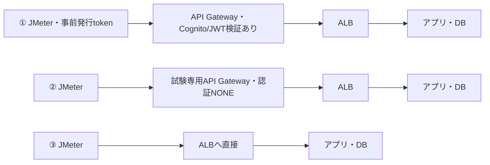

# API Gateway経由のJMeter負荷試験 詳細解説

**調査基準日：2026年10月21日**

②の「Cognito Authorizerを外してGatewayのトークン検証を省く」方法は実現できます。安全に比較できる形は、試験専用APIで認証要求を明示的に解除し、実URL・バックエンド到達・業務結果まで確認することです。①は発行の省略、②はGatewayの検証の省略、③はGateway経路の省略です。

この資料は公式仕様を調べた解説と実施手順です。AWSへの設定変更・実トークンの発行・実APIへの負荷試験は行っていません。実環境のAPI種別・ネットワーク・ALB・アプリ認証は未提示です。

## 目次

1. API Gateway経由のJMeter負荷試験：結論
2. ①・②・③は何が違うか
3. 入場券と門で理解する認証のしくみ
4. ②の実現性と、よくある落とし穴
5. ②を専用APIで実施する手順
6. ②のOpenAPI・CLI・IaC設定例
7. ②と同じ効果の方法と、目的を満たす別の方法
8. ①：24時間トークンを正しく運用する
9. ③：ALBを直接呼ぶ場合の成立条件
10. JMeterの組み立て方と、結果の読み方
11. 変更後の検証表と、元に戻す手順
12. なぜこの構成と試験方法が必要になったのか
13. 用語と、よくある質問
14. 確認した公式資料と、根拠の対応

## 経路を比べる図

矢印はリクエストの通り道です。②・③でも、ALBやアプリが独自に行う認証は残る場合があります。



Cognitoでの発行はこの図の前段または更新時に別途行います。Gatewayの認証を残す場合、事前発行してもtokenの検証は行われます。

## 00_結論　API Gateway経由のJMeter負荷試験：結論

調査基準日：2026年10月21日。AWS・Apache・標準仕様の一次資料で確認。実環境の構成は未提示のため、REST APIを主軸にHTTP APIとの差も説明する。

| 問い | 結論と判断理由 | 読む場所 |
| --- | --- | --- |
| ②は実現できるか | できる。試験対象の各メソッド／ルートでAPI Gatewayの認証要求を解除する。OpenAPIのAuthorizer定義だけを消しても、security参照・継承・既存設定が残ると意図どおりにならない。RESTはデプロイ後の実URLで確認する。 | 03・04・05 |
| 最初におすすめする形 | 実利用の性能確認は①または通常期限＋更新。Gatewayを残してバックエンド寄りに測る補助試験は②の専用API。ALB＋アプリの限界を調べる補助試験は③。同じ試験データと負荷条件で順に比較する。これは試験設計上の提案。 | 01・06・09 |
| ①が省くもの | トークンの発行処理を計測ループの外へ移す。Cognito発行のaccess tokenは最大24時間に設定できるが、API Gatewayの署名・期限・スコープ等の検証は残る。 | 07／[S01](https://docs.aws.amazon.com/cognito-user-identity-pools/latest/APIReference/API_TokenValidityUnitsType.html)・[S04](https://docs.aws.amazon.com/apigateway/latest/developerguide/apigateway-enable-cognito-user-pool.html) |
| ②が省くもの | API Gatewayに付けたCognito／JWT Authorizerの判定。Gatewayの経路、スロットリング、統合は残る。ALBやアプリが独自にJWTを検証する場合、その検証は別途残る。 | 02・03 |
| ③が省くもの | API Gatewayそのものと、その入口で行っていた処理。結果は「ALBへ直接つないだときの性能」であり、利用者がAPI Gatewayを通る本番経路の性能保証にはそのまま使えない。 | 08 |
| 特に見落としやすい点 | 認証を外すと、Gatewayが作っていた検証済みユーザー情報も作られない。ユーザーIDやテナントIDがバックエンドへ届かず、401/403/500になったり、別の処理経路で成功したりする。HTTP成功だけでなく返却内容も確かめる。 | 03・10 |
| 専用APIを推す理由 | 同一REST APIの別ステージは別デプロイを参照できるが、編集するメソッド定義はAPI内で共有される。後日の本番再デプロイへの混入を避けるため、別API ID、可能なら別の試験環境で定義を分ける。 | 04／[S08](https://docs.aws.amazon.com/apigateway/latest/developerguide/how-to-deploy-api.html)・[S09](https://docs.aws.amazon.com/apigateway/latest/developerguide/http-api-stages.html) |
| 最新情報① | 2025年11月21日のAWS発表で、REST APIから内部ALBへVPC Link V2による直接プライベート統合が追加された。「REST APIでは内部ALBの前に必ずNLBが必要」という古い説明は現在の全構成には当てはまらない。 | 11／[S43](https://aws.amazon.com/about-aws/whats-new/2025/11/api-gateway-rest-apis-integration-load-balancer/)・[S56](https://docs.aws.amazon.com/apigateway/latest/developerguide/apigateway-vpc-links-v2.html) |
| 最新情報② | 2026年8月31日付のAWS発表ではGetClientTokenが追加され、User Poolドメインを用意せずM2M access tokenを取得できる。これは発行経路の追加で、API Gatewayの検証を外す機能ではない。 | 06・11／[S44](https://aws.amazon.com/about-aws/whats-new/2026/08/amazon-cognito-get-client-token/)・[S45](https://docs.aws.amazon.com/cognito-user-identity-pools/latest/APIReference/API_GetClientToken.html) |
| この資料で確認したこと | 公式仕様、設定の意味、方式の成立条件、設定例の構造を確認した。AWSへの設定変更、トークン発行、実APIへの負荷試験は実施していない。実環境の権限・統合・ネットワーク・クォータは10の手順で確認する。 | 10・13 |
| 読み進める順番 | 初めてなら「02 しくみ」から「01 比較」へ。②を実装する担当者は「03 実現性」「04 手順」「05 設定例」「10 検証」。判断を説明する担当者は「00 結論」「06 代替案」「11 歴史」を読む。 | 各シート番号 |

## 01_方式比較　①・②・③は何が違うか

「トークン発行を省く」「Gatewayの検証を省く」「Gatewayを通らない」は、それぞれ違う試験。○＝含む、外す＝計測経路から除く、条件次第＝構成を確認する。

| 比較すること | ① 事前トークン | ② Authorizer解除 | ③ ALB直接 | どう読むか | 根拠 |
| --- | --- | --- | --- | --- | --- |
| 小学校のたとえ | 先に入場券をもらい、門で券を見せて入る。 | 学校の門は通るが、券を見る係の確認を省く。 | 学校の門を通らず、校庭の入口へ直接行く。 | どの係を通ったかが違うため、速さの数字も意味が違う。 | 説明用のたとえ |
| Gateway通過 | ○ | ○ | 外す | API Gatewayの有無が③の大きな違い。 | [S04](https://docs.aws.amazon.com/apigateway/latest/developerguide/apigateway-enable-cognito-user-pool.html)・[S24](https://docs.aws.amazon.com/apigateway/latest/developerguide/http-api-develop-integrations-private.html) |
| Cognitoでの発行 | 試験前。長時間なら必要に応じて更新。 | Gatewayでは不要。アプリが求める場合は必要。 | アプリ／ALBの設定次第。 | ②・③でもトークンが完全に不要とは限らない。 | [S23](https://docs.aws.amazon.com/elasticloadbalancing/latest/application/listener-authenticate-users.html)・[S55](https://docs.aws.amazon.com/cognito/latest/developerguide/amazon-cognito-user-pools-using-tokens-verifying-a-jwt.html) |
| GatewayでのJWT等検証 | ○。毎回のAPI呼び出しに認可処理が存在する。 | 対象メソッド／ルートで外す。 | Gatewayを通らないので存在しない。 | 事前発行しても、API呼び出し側の検証は消えない。 | [S04](https://docs.aws.amazon.com/apigateway/latest/developerguide/apigateway-enable-cognito-user-pool.html)・[S10](https://docs.aws.amazon.com/apigateway/latest/developerguide/http-api-jwt-authorizer.html) |
| ALBの認証 | 設定していれば残る。 | 設定していれば残る。 | 設定していれば残る。 | ALB独自のOIDC認証はGatewayとは別の関門。 | [S23](https://docs.aws.amazon.com/elasticloadbalancing/latest/application/listener-authenticate-users.html) |
| アプリ側の認証・認可 | 残る。 | 残る。ユーザー情報不足に注意。 | 残る。信頼するヘッダーやJWTの入口が変わる。 | 業務ルールまで無条件に通すと測る処理が変わる。 | [S04](https://docs.aws.amazon.com/apigateway/latest/developerguide/apigateway-enable-cognito-user-pool.html)・[S55](https://docs.aws.amazon.com/cognito/latest/developerguide/amazon-cognito-user-pools-using-tokens-verifying-a-jwt.html) |
| Gatewayの制限・変換 | ○。WAF、request validation等はAPI種別・設定次第。 | ○。Authorizer以外は設定を保てる。 | 外す。ALB／アプリ側の仕組みだけ残る。 | ②で429が消えるとは限らない。 | [S11](https://docs.aws.amazon.com/apigateway/latest/developerguide/http-api-vs-rest.html)・[S27](https://docs.aws.amazon.com/apigateway/latest/developerguide/limits.html) |
| 検証済みクレーム | Gatewayの機能として取得できる。 | Gatewayによるクレーム生成はない。 | Gatewayによるクレーム生成はない。 | アプリが使うsubやtenant情報を別途設計する必要がある。 | [S04](https://docs.aws.amazon.com/apigateway/latest/developerguide/apigateway-enable-cognito-user-pool.html)・[S10](https://docs.aws.amazon.com/apigateway/latest/developerguide/http-api-jwt-authorizer.html) |
| 実利用への近さ | 通常の認証経路を保てる。全ユーザーで1枚共有すると偏りは生じる。 | 認証以外のGateway経路を保つ補助試験。 | ALB以降の性能を切り分ける補助試験。 | 試験目的ごとに採用する。実測前に速さの順位は断定しない。 | 設計上の評価 |
| 設定変更の大きさ | 試験用app clientとトークン供給。API変更を避けられる。 | 試験専用APIの認証・入口制限・必要なマッピングを整える。 | 直接接続できるネットワーク、TLS、Host、パスを整える。 | 今の構成次第で作業量は変わる。 | [S01](https://docs.aws.amazon.com/cognito-user-identity-pools/latest/APIReference/API_TokenValidityUnitsType.html)・[S08](https://docs.aws.amazon.com/apigateway/latest/developerguide/how-to-deploy-api.html)・[S24](https://docs.aws.amazon.com/apigateway/latest/developerguide/http-api-develop-integrations-private.html) |
| 主な失敗 | 開始前に期限を消費、scope違い、全スレッド同時更新。 | security継承、merge残存、再デプロイ漏れ、claims欠落。 | 内部ALBへの到達不可、ログイン画面、Host/TLS違い。 | 03・07・08・10の手順で先に少量疎通する。 | [S04](https://docs.aws.amazon.com/apigateway/latest/developerguide/apigateway-enable-cognito-user-pool.html)・[S07](https://docs.aws.amazon.com/apigateway/latest/developerguide/api-gateway-import-api-update.html)・[S23](https://docs.aws.amazon.com/elasticloadbalancing/latest/application/listener-authenticate-users.html) |
| 費用への影響 | Gateway呼び出し、Cognito発行等はそれぞれの課金条件。 | Gateway課金は残る。専用APIの運用とログ等も考慮。 | Gatewayリクエスト分は生じないがALB、計算資源、通信等は残る。 | 単価・無償枠を固定せず、対象リージョンと契約の料金で見積もる。 | 構成に基づく整理 |
| 使う場面 | 最終的なAPI性能評価。長時間試験は期限内に更新。 | 認証部分を除いたGateway＋アプリの切り分け。 | ALB＋アプリ＋DBの処理能力を調べる。 | 3種類の結果を同じ指標で並べると原因を探しやすい。 | 試験設計の提案 |

## 02_しくみと前提　入場券と門で理解する認証のしくみ

たとえは理解のためのもの。技術上の判断は「正確な説明」と根拠資料を使う。実際のGateway種別、統合、ALB認証、アプリの認証は未提示。

### JMeter

**たくさんのお客さん役をする機械。**

HTTP等のリクエストを何人分も送って、所要時間、成功率、処理件数を測る。JMeterが設定した人数と、実際にサーバーへ同時到着する数は同じとは限らない。

実施・判断：人数だけでなく実際のRPSと応答時間を記録する。

根拠：[S33](https://jmeter.apache.org/usermanual/best-practices.html)・[S34](https://jmeter.apache.org/usermanual/component_reference.html)

### Cognito

**入場券を発行する受付。**

ユーザーのログインやM2Mのクライアント認証を行い、署名付きトークンを発行する。User Poolsと、AWS資格情報を扱うIdentity Poolsは別の機能。

実施・判断：本件のCognito AuthorizerはUser Poolsを前提に確認する。

根拠：[S04](https://docs.aws.amazon.com/apigateway/latest/developerguide/apigateway-enable-cognito-user-pool.html)・[S29](https://docs.aws.amazon.com/cognito/latest/developerguide/amazon-cognito-user-pools-using-the-access-token.html)・[S30](https://docs.aws.amazon.com/cognito/latest/developerguide/cognito-user-pools-define-resource-servers.html)

### API Gateway

**学校の門と案内係。**

APIの入口として経路、認証連携、スロットリング等を扱う。REST APIとHTTP APIという異なる製品があり、同じ設定名・機能が全て共通ではない。

実施・判断：管理画面／IaCでAPI種別を最初に確認する。

根拠：[S11](https://docs.aws.amazon.com/apigateway/latest/developerguide/http-api-vs-rest.html)

### Authorizer

**入場券が使えるかを見る係。**

API Gatewayがリクエストを許可するか判断する仕組み。RESTのCognito User Pools、HTTPのJWT、独自LambdaのCUSTOM等がある。

実施・判断：どのAuthorizerをどのメソッドが使うか一覧にする。

根拠：[S05](https://docs.aws.amazon.com/apigateway/latest/developerguide/api-gateway-swagger-extensions-authorizer.html)・[S15](https://docs.aws.amazon.com/apigateway/latest/developerguide/apigateway-use-lambda-authorizer.html)・[S16](https://docs.aws.amazon.com/apigateway/latest/developerguide/http-api-lambda-authorizer.html)

### ALB

**来た人を空いている教室へ案内する係。**

Application Load BalancerはHTTP/HTTPSの条件で宛先を振り分ける。設定次第でCognito／OIDC認証も行う。API Gatewayを外してもALBの認証は残り得る。

実施・判断：listener ruleのauthenticate-*とforwardを確認する。

根拠：[S23](https://docs.aws.amazon.com/elasticloadbalancing/latest/application/listener-authenticate-users.html)

### アプリとDB

**授業をする教室と、記録を置く本棚。**

業務処理と保存を行う部分。JWT検証に加え、所有者、ロール、テナント単位の許可をここで確認していることがある。

実施・判断：②・③でも本来測りたい業務ロジックを通す。

根拠：設計上の整理

### access token

**できることと期限が書かれた入場券。**

APIへのアクセス権を示す。CognitoではJWT形式で、scope、exp、token_use等を持つ。JWTの中身を読めるだけでは正しさは証明できない。

実施・判断：署名・発行元・期限・用途・権限を適切な層で検証する。

根拠：[S29](https://docs.aws.amazon.com/cognito/latest/developerguide/amazon-cognito-user-pools-using-the-access-token.html)・[S55](https://docs.aws.amazon.com/cognito/latest/developerguide/amazon-cognito-user-pools-using-tokens-verifying-a-jwt.html)

### ID token

**その人が誰かを説明する名札。**

ログインしたユーザーの情報をアプリへ伝える用途。REST Cognito Authorizerはスコープ設定の有無でトークンの扱いが変わるため、access tokenと無条件に交換できない。

実施・判断：既存APIの契約がどちらを求めているか調べる。

根拠：[S04](https://docs.aws.amazon.com/apigateway/latest/developerguide/apigateway-enable-cognito-user-pool.html)

### refresh token

**期限が来た入場券を交換するための引換券。**

新しいID/access tokenを得るためのもの。access tokenの期限そのものを延ばす文字列ではない。API GatewayのAuthorizationへそのまま入れない。

実施・判断：更新処理は発行／更新の専用経路で行う。

根拠：[S32](https://docs.aws.amazon.com/cognito/latest/developerguide/amazon-cognito-user-pools-using-the-refresh-token.html)

### JWTの署名

**受付だけが付けられる、本物の印。**

発行者の秘密鍵と検証者の公開鍵で改ざんを確かめる。通常の署名付きJWTは暗号化とは異なり、中身は読める。expを書き換えると署名が一致しなくなる。

実施・判断：期限を書き換えた自作トークンを①の代わりにしない。

根拠：[S36](https://www.rfc-editor.org/rfc/rfc7519)・[S55](https://docs.aws.amazon.com/cognito/latest/developerguide/amazon-cognito-user-pools-using-tokens-verifying-a-jwt.html)

### scope

**図書室だけ、体育館も、という利用範囲。**

APIの操作権限。RESTメソッドで複数のscopeを指定した場合は、トークン内のいずれか一致で許可される。全scopeが必須と誤解しない。

実施・判断：resource-server/scope形式の値を実際のAPIと合わせる。

根拠：[S04](https://docs.aws.amazon.com/apigateway/latest/developerguide/apigateway-enable-cognito-user-pool.html)・[S30](https://docs.aws.amazon.com/cognito/latest/developerguide/cognito-user-pools-define-resource-servers.html)

### 発行と検証は別

**受付で券をもらう時間と、門で券を見せる時間は別。**

Cognitoへのトークン取得リクエストと、API GatewayがJWTを検証する処理は別経路。JWTは公開鍵で検証でき、毎回Cognitoへログインし直す設計ではない。HTTP JWTの公開鍵キャッシュは認証結果の全省略とも異なる。

実施・判断：Cognitoが遅いと決めつけず、発行とAPI本体を別計測する。

根拠：[S10](https://docs.aws.amazon.com/apigateway/latest/developerguide/http-api-jwt-authorizer.html)・[S31](https://docs.aws.amazon.com/cognito/latest/developerguide/token-endpoint.html)・[S55](https://docs.aws.amazon.com/cognito/latest/developerguide/amazon-cognito-user-pools-using-tokens-verifying-a-jwt.html)

### OpenAPI

**門・部屋・決まりを書いた設計図。**

APIのパス、メソッド、入出力、security等を記述する。標準部分に加え、x-amazon-apigateway-*拡張でAWS固有の統合やAuthorizerを表現する。

実施・判断：文書編集だけで完了せず、実際のAWS設定まで反映する。

根拠：[S05](https://docs.aws.amazon.com/apigateway/latest/developerguide/api-gateway-swagger-extensions-authorizer.html)・[S06](https://spec.openapis.org/oas/v3.0.3.html#operation-object)・[S25](https://docs.aws.amazon.com/apigateway/latest/developerguide/api-gateway-swagger-extensions-integration.html)

### 定義と使用箇所

**係の名簿と、どの門に置くかの指示は別。**

components.securitySchemes／securityDefinitionsは認証方式の宣言。securityは操作に要求する方式の参照。方式名が定義されているだけでは全操作に適用されない。

実施・判断：定義とsecurity参照の両方を検索する。

根拠：[S05](https://docs.aws.amazon.com/apigateway/latest/developerguide/api-gateway-swagger-extensions-authorizer.html)・[S06](https://spec.openapis.org/oas/v3.0.3.html#operation-object)

### 認証と認可

**誰か確かめることと、入ってよい部屋を決めること。**

ログインできた人でも他人のデータを見てよいとは限らない。②で入口の認証を外しても、アプリ内の業務上の認可契約は別に存在する。

実施・判断：試験用のユーザー・ロール・データを対応させる。

根拠：[S29](https://docs.aws.amazon.com/cognito/latest/developerguide/amazon-cognito-user-pools-using-the-access-token.html)・[S30](https://docs.aws.amazon.com/cognito/latest/developerguide/cognito-user-pools-define-resource-servers.html)

### 入口と出口の閉域

**門を外から見えなくすることと、教室までの廊下を内側に作ること。**

Private APIはクライアント側からの入口が閉域。Private integrationはGatewayからALB等への出口が閉域。VPC LinkがあるだけでAPI自体がPrivateになるわけではない。

実施・判断：入口とバックエンド接続を別々に確認する。

根拠：[S12](https://docs.aws.amazon.com/apigateway/latest/developerguide/apigateway-private-apis.html)・[S24](https://docs.aws.amazon.com/apigateway/latest/developerguide/http-api-develop-integrations-private.html)・[S57](https://docs.aws.amazon.com/apigateway/latest/developerguide/private-integration.html)


## 03_②実現性　②の実現性と、よくある落とし穴

結論：API Gatewayのメソッド／ルートを認証なしにできる。ただし実行時に通過できるかは、ほかの入口制限とバックエンドの契約にも依存する。


### OpenAPIで外す場所を間違えない

### Authorizer定義だけ削除

**名簿から係を消しても、門の指示書に名前が残る。**

securityにCognitoAuthorizer参照が残ると、未定義参照やインポート警告・失敗等になり得る。既存APIへmergeした場合は、書かなかった設定が残る可能性もある。

実施・判断：定義削除より、対象操作のsecurityを明示的に制御する。

根拠：[S06](https://spec.openapis.org/oas/v3.0.3.html#operation-object)・[S07](https://docs.aws.amazon.com/apigateway/latest/developerguide/api-gateway-import-api-update.html)

### securityを省略

**何も書かなければ、学校全体の決まりを引き継ぐ。**

操作のsecurityを省略するとrootのsecurityが適用される。rootがCognito要求なら、操作からsecurityを消しただけでは解除されない。

実施・判断：rootとoperationの両方を確認する。

根拠：[S06](https://spec.openapis.org/oas/v3.0.3.html#operation-object)

### security: []

**この入口では券の確認を求めない、と明記する。**

空配列はその操作について上位securityを上書きし、認証要件を外す表現。試験専用APIで対象操作すべてに明示し、AWS反映後はauthorizationType=NONEを確認する。

実施・判断：05の差分例A・Bを使って意味を確認する。

根拠：[S06](https://spec.openapis.org/oas/v3.0.3.html#operation-object)・[S18](https://docs.aws.amazon.com/cli/latest/reference/apigateway/update-method.html)・[S19](https://docs.aws.amazon.com/cli/latest/reference/apigatewayv2/update-route.html)

### CognitoAuthorizer: []

**係に頼むが、追加の利用範囲は指定しない。**

security配列内の方式名に付く空配列は、方式そのものを外す意味ではない。REST CognitoでscopeなしはID tokenとして扱う設定になる。security: []とは階層が違う。

実施・判断：空配列がどこに置かれたかを確認する。

根拠：[S04](https://docs.aws.amazon.com/apigateway/latest/developerguide/apigateway-enable-cognito-user-pool.html)・[S06](https://spec.openapis.org/oas/v3.0.3.html#operation-object)

### security: [{}]

**券なしでもよい選択肢を足す、という別の書き方。**

OpenAPI標準上は匿名アクセスの選択肢を表せるが、API Gatewayの認証表現には制限がある。特にHTTP APIで1操作に複数認証方式を並べる設計は使えない。

実施・判断：本件では単純なsecurity: []で要求解除を表す。

根拠：[S06](https://spec.openapis.org/oas/v3.0.3.html#operation-object)・[S47](https://docs.aws.amazon.com/apigateway/latest/developerguide/http-api-open-api.html)

### 拡張だけを削除

**係の種類だけを空欄にする。**

x-amazon-apigateway-authorizerだけを消し、apiKey型のsecurity schemeやsecurity参照を残すと、別の意味や不完全な定義になる。なおCognito schemeのtype: apiKeyはAWSによる表現で、Usage PlanのAPIキーと同義ではない。

実施・判断：文字列置換で一部だけを切り取らない。

根拠：[S04](https://docs.aws.amazon.com/apigateway/latest/developerguide/apigateway-enable-cognito-user-pool.html)・[S05](https://docs.aws.amazon.com/apigateway/latest/developerguide/api-gateway-swagger-extensions-authorizer.html)・[S14](https://docs.aws.amazon.com/apigateway/latest/developerguide/api-gateway-api-usage-plans.html)

### 全部を無認証にする場合

**全ての対象入口の指示をそろえる。**

rootをsecurity: []にしても、operation側のCognito指定はそのまま上書きとして残る。各GET/POST等にあるsecurityを列挙する。ANYやproxy、$defaultも別に確認する。

実施・判断：ルート×メソッドの一覧を作って変更漏れを防ぐ。

根拠：[S06](https://spec.openapis.org/oas/v3.0.3.html#operation-object)・[S58](https://docs.aws.amazon.com/apigateway/latest/developerguide/api-gateway-swagger-extensions-any-method.html)

### OPTIONSだけ通る

**案内窓口に聞けても、教室へ入れるとは限らない。**

CORS preflightのOPTIONS成功は、実際のGET/POSTが認証なしで通る証拠にならない。JMeterはブラウザーと異なりCORSの制限を通常強制しない。

実施・判断：実際の業務メソッドを実URLで送って確認する。

根拠：[S11](https://docs.aws.amazon.com/apigateway/latest/developerguide/http-api-vs-rest.html)・[S34](https://jmeter.apache.org/usermanual/component_reference.html)


### AWSへ反映する際の落とし穴

### merge

**新しい紙と古い紙を合わせる。**

インポート本文にない設定を保持する用途。認証を削除したつもりでも、省略が削除の指示になるとは限らない。明示した操作security: []の結果も取得APIと実呼び出しで確かめる。

実施・判断：省略＝削除と考えない。結果の設定を監査する。

根拠：[S07](https://docs.aws.amazon.com/apigateway/latest/developerguide/api-gateway-import-api-update.html)

### overwrite

**API定義を新しい設計図にそろえる。**

未記載のAPIレベル設定が既定値になるなど、認証以外へも影響し得る。統合、ポリシー、バリデーション等を含めて管理する。stages等、別管理の情報もある。

実施・判断：専用APIへ完全な定義を適用する。断片を本番へoverwriteしない。

根拠：[S07](https://docs.aws.amazon.com/apigateway/latest/developerguide/api-gateway-import-api-update.html)・[S50](https://docs.aws.amazon.com/en_en/apigateway/latest/developerguide/api-gateway-export-api.html)

### デプロイ忘れ

**設計図を直しても、門の現場へまだ配っていない。**

RESTのメソッドやAuthorizer変更は再デプロイが必要。HTTP APIもauto deployを有効にしていなければ明示デプロイする。

実施・判断：変更したステージのURLとdeployment IDを確認する。

根拠：[S08](https://docs.aws.amazon.com/apigateway/latest/developerguide/how-to-deploy-api.html)・[S09](https://docs.aws.amazon.com/apigateway/latest/developerguide/http-api-stages.html)

### 別ステージなら安全か

**校門を二つ名付けても、工事の設計図が共通の場合がある。**

同一API内の認証はメソッド／ルートの設定。異なるデプロイをステージごとに参照することはできるが、stage variableだけでネイティブCognito/JWTの有無を自動切替する仕組みではない。

実施・判断：専用API IDを基本案にし、本番への定義混入を防ぐ。

根拠：[S08](https://docs.aws.amazon.com/apigateway/latest/developerguide/how-to-deploy-api.html)・[S09](https://docs.aws.amazon.com/apigateway/latest/developerguide/http-api-stages.html)・[S20](https://docs.aws.amazon.com/AWSCloudFormation/latest/TemplateReference/aws-resource-apigateway-method.html)

### APIキー必須が残る

**券の確認を外しても、別の受付番号が必要。**

apiKeyRequired、Usage Plan、resource policy、WAF、mTLS等はAuthorizerと別。NONEにしても、それらで拒否されることがある。

実施・判断：何を残す試験かを記録し、エラー発生層を追う。

根拠：[S11](https://docs.aws.amazon.com/apigateway/latest/developerguide/http-api-vs-rest.html)・[S14](https://docs.aws.amazon.com/apigateway/latest/developerguide/api-gateway-api-usage-plans.html)・[S51](https://docs.aws.amazon.com/apigateway/latest/developerguide/rest-api-mutual-tls.html)

### Authorization必須の指定

**券の確認を外しても、封筒を出す決まりが残ることがある。**

Authorizationヘッダーをrequiredなrequest parameterとして宣言し、request validatorで必須チェックしている場合は、AuthorizerをNONEにしてもヘッダー省略が別の理由で拒否され得る。

実施・判断：tokenなしも試す場合、ヘッダー必須指定とrequest validatorの関連を確認する。

根拠：[S11](https://docs.aws.amazon.com/apigateway/latest/developerguide/http-api-vs-rest.html)・[S18](https://docs.aws.amazon.com/cli/latest/reference/apigateway/update-method.html)・[S25](https://docs.aws.amazon.com/apigateway/latest/developerguide/api-gateway-swagger-extensions-integration.html)

### CLIの削除例に注意

**使えない消し方をまねしない。**

公式Patch OperationsではREST Methodの/authorizerIdにop:removeは非対応。/authorizationTypeをreplaceしてNONEにする。不要な関連付けまで整える場合はIaC／完全な定義で扱い、設定を確認する。

実施・判断：05の例Dではunsupportedなremoveを使わない。

根拠：[S17](https://docs.aws.amazon.com/apigateway/latest/api/patch-operations.html#UpdateMethod)・[S18](https://docs.aws.amazon.com/cli/latest/reference/apigateway/update-method.html)


### バックエンドへ届いてからの落とし穴

### クレームがなくなる

**確認係が作っていた名札がもらえない。**

RESTの$context.authorizer.claims等、HTTP LambdaイベントのrequestContext.authorizer.jwt.claims等は、Authorizerが検証した結果に依存する。NONEでは同じ情報が作られない。

実施・判断：マッピングとアプリが参照する項目を一覧化する。

根拠：[S04](https://docs.aws.amazon.com/apigateway/latest/developerguide/apigateway-enable-cognito-user-pool.html)・[S10](https://docs.aws.amazon.com/apigateway/latest/developerguide/http-api-jwt-authorizer.html)

### Authorizationヘッダー

**封筒を運ぶことと、中身を本物と確認することは違う。**

Authorizer解除とヘッダー転送設定は別。HTTP proxy／明示マッピングなど統合方式によって届き方が変わる。届いた生JWTもGateway検証済みとは扱えない。

実施・判断：テスト用バックエンドログで有無だけ確認し、トークン値は記録しない。

根拠：[S25](https://docs.aws.amazon.com/apigateway/latest/developerguide/api-gateway-swagger-extensions-integration.html)・[S55](https://docs.aws.amazon.com/cognito/latest/developerguide/amazon-cognito-user-pools-using-tokens-verifying-a-jwt.html)

### アプリ独自JWT検証

**教室の入口にも券を見る先生がいる。**

アプリが署名・期限を検証していれば②でも有効なトークンが必要。②はGateway部分だけを外す方法で、アプリの設定まで自動的に変えない。

実施・判断：Gateway由来の401/403とアプリ由来を区別する。

根拠：[S55](https://docs.aws.amazon.com/cognito/latest/developerguide/amazon-cognito-user-pools-using-tokens-verifying-a-jwt.html)

### 偽ユーザーヘッダー

**自分で書いた名札を本物と思い込ませてはいけない。**

任意のX-Test-UserやX-Tenantを本番で信頼すると権限の偽装につながる。試験専用バックエンドが固定の試験主体を内部設定から使う設計は可能だが、その業務経路の違いを測定条件に含める。

実施・判断：必要時だけ、閉じた試験環境・固定主体・入力ヘッダー破棄をセットで設計する。

根拠：[S04](https://docs.aws.amazon.com/apigateway/latest/developerguide/apigateway-enable-cognito-user-pool.html)・[S55](https://docs.aws.amazon.com/cognito/latest/developerguide/amazon-cognito-user-pools-using-tokens-verifying-a-jwt.html)／設計提案

### 200でも同じ処理か

**「入れた」と「同じ授業を受けた」は別。**

匿名向けの軽いレスポンス、空データ、キャッシュ、権限不足の代替ページが200を返す可能性がある。HTTPコードだけを見ると負荷試験を誤って成功扱いする。

実施・判断：JSONのID、件数、業務結果までAssertionする。

根拠：[S34](https://jmeter.apache.org/usermanual/component_reference.html)／試験設計

### ②を採れる条件

**省いた係以外の動きが説明できること。**

対象APIを分離し、呼出元を制限でき、クレーム依存を把握し、業務処理を保ち、デプロイと復旧を検証できるなら、Gateway経由の補助試験として成立する。

実施・判断：認証ありの試験結果と区別して報告する。

根拠：本節の条件を統合した判断


## 04_②実施手順　②を専用APIで実施する手順

この資料は設定例と確認手順を示す。AWSへの操作は行っていない。既存IaCがある場合は、その定義とデプロイ方式を正とする。

### 1 目的を固定する

**何の速さを調べるかを先に決める。**

「API Gatewayの経路を残し、GatewayのCognito検証を除いたときの業務API性能」を測定対象にする。ログインの負荷、権限テスト、最終的な本番性能は別のシナリオに分ける。

実施・判断：試験名、対象処理、成功条件、終了条件を記録する。

根拠：試験設計の提案

### 2 構成を調べる

**門・廊下・教室を地図にする。**

REST/HTTP、API ID、stage、deployment、domain mapping、VPC Link、ALB listener、アプリの認証方式を調べる。Authorizerの名称だけでAPI種別を推定しない。

実施・判断：受信からDBまでの経路図を1本作る。

根拠：[S05](https://docs.aws.amazon.com/apigateway/latest/developerguide/api-gateway-swagger-extensions-authorizer.html)・[S11](https://docs.aws.amazon.com/apigateway/latest/developerguide/http-api-vs-rest.html)・[S56](https://docs.aws.amazon.com/apigateway/latest/developerguide/apigateway-vpc-links-v2.html)

### 3 対象を一覧化

**どの入口を開けるか、名簿を作る。**

パス、HTTPメソッド、認証方式、Authorizer、scope、apiKeyRequiredを一覧化。ANY、proxy、$defaultと明示ルートの優先関係も確認する。

実施・判断：GETだけ変更してPOSTを忘れない。

根拠：[S18](https://docs.aws.amazon.com/cli/latest/reference/apigateway/update-method.html)・[S19](https://docs.aws.amazon.com/cli/latest/reference/apigatewayv2/update-route.html)・[S58](https://docs.aws.amazon.com/apigateway/latest/developerguide/api-gateway-swagger-extensions-any-method.html)

### 4 元の状態を保存

**工事前の写真を残す。**

OpenAPI exportにAWS拡張を含める。IaC、stage settings、deployment ID、resource policy、domain mapping、APIキー関連、ログ、WAF、クォータも記録する。OpenAPIだけでは全設定の完全バックアップにならない。

実施・判断：機密情報を除いた構成差分と復旧先を用意する。

根拠：[S07](https://docs.aws.amazon.com/apigateway/latest/developerguide/api-gateway-import-api-update.html)・[S08](https://docs.aws.amazon.com/apigateway/latest/developerguide/how-to-deploy-api.html)・[S50](https://docs.aws.amazon.com/en_en/apigateway/latest/developerguide/api-gateway-export-api.html)

### 5 専用APIを作る

**練習用の門を分ける。**

別API IDをIaCの別環境として管理する。バックエンドも非本番にするのが基本。APIだけ分けて本番DBや本番ALBを共用すると負荷は共有される。

実施・判断：API ID、URL、バックエンドの試験対象を照合する。

根拠：[S08](https://docs.aws.amazon.com/apigateway/latest/developerguide/how-to-deploy-api.html)／設計提案

### 6 入口を制限

**係を減らす代わりに、使う人と道を決める。**

RESTならPrivate API＋endpoint/resource policy、または固定送信元IPを制限したresource policy等を検討。HTTPには同じresource policy機能がないためIAMやmTLS等を別案として評価する。

実施・判断：許可元の成功と、許可外の拒否を両方試す。

根拠：[S11](https://docs.aws.amazon.com/apigateway/latest/developerguide/http-api-vs-rest.html)・[S12](https://docs.aws.amazon.com/apigateway/latest/developerguide/apigateway-private-apis.html)・[S13](https://docs.aws.amazon.com/apigateway/latest/developerguide/apigateway-resource-policies-examples.html)・[S51](https://docs.aws.amazon.com/apigateway/latest/developerguide/rest-api-mutual-tls.html)

### 7 OpenAPIを編集

**券の確認をしない入口を明記する。**

対象operationへsecurity: []。全操作が対象ならrootと全operationの競合を解消する。未使用のCognito schemeは残っていても要求がなければ適用されないが、試験専用定義として整理してよい。

実施・判断：統合・レスポンス・パラメーター・バリデーションは意図した差だけにする。

根拠：[S05](https://docs.aws.amazon.com/apigateway/latest/developerguide/api-gateway-swagger-extensions-authorizer.html)・[S06](https://spec.openapis.org/oas/v3.0.3.html#operation-object)・[S25](https://docs.aws.amazon.com/apigateway/latest/developerguide/api-gateway-swagger-extensions-integration.html)

### 8 クレーム依存を処理

**名札がないと困る教室を探す。**

authorizer.claims、authorizer.jwt、認証済みユーザーヘッダー、tenant、subの参照箇所を確認。必要なら有効JWTをアプリで検証し続ける方式、または固定試験主体の専用バックエンドを選ぶ。

実施・判断：この変更によって省かれる処理を結果に書く。

根拠：[S04](https://docs.aws.amazon.com/apigateway/latest/developerguide/apigateway-enable-cognito-user-pool.html)・[S10](https://docs.aws.amazon.com/apigateway/latest/developerguide/http-api-jwt-authorizer.html)・[S55](https://docs.aws.amazon.com/cognito/latest/developerguide/amazon-cognito-user-pools-using-tokens-verifying-a-jwt.html)

### 9 インポート／反映

**設計図を現場へ配る。**

完全な定義を専用APIへ反映する。警告を無視せず確認。mergeなら省略された既存設定、overwriteなら欠落した必要設定を確認する。RESTとHTTPのCLIコマンドを混用しない。

実施・判断：05の例を使い、実APIの種別に合わせる。

根拠：[S07](https://docs.aws.amazon.com/apigateway/latest/developerguide/api-gateway-import-api-update.html)・[S18](https://docs.aws.amazon.com/cli/latest/reference/apigateway/update-method.html)・[S19](https://docs.aws.amazon.com/cli/latest/reference/apigatewayv2/update-route.html)・[S47](https://docs.aws.amazon.com/apigateway/latest/developerguide/http-api-open-api.html)

### 10 デプロイ

**試験用の門に新しい設計を使わせる。**

RESTは専用stageへcreate-deployment等で反映。HTTPはauto deploy設定を確認して必要なデプロイを行う。独自ドメインが古いstageへ向いていないかも確認する。

実施・判断：API ID／stage／deployment ID／URLを試験記録に固定する。

根拠：[S08](https://docs.aws.amazon.com/apigateway/latest/developerguide/how-to-deploy-api.html)・[S09](https://docs.aws.amazon.com/apigateway/latest/developerguide/http-api-stages.html)

### 11 設定を読み返す

**工事をした人以外の目でも確かめる。**

REST get-method、HTTP get-route等で対象のauthorizationType=NONEを取得する。Authorizerオブジェクトが残っていても、メソッドが要求しなければそれ自体は実行理由にならない。

実施・判断：全対象の結果を一覧にして変更前と比較する。

根拠：[S18](https://docs.aws.amazon.com/cli/latest/reference/apigateway/update-method.html)・[S19](https://docs.aws.amazon.com/cli/latest/reference/apigatewayv2/update-route.html)

### 12 少量の疎通試験

**最初は1人だけ通す。**

許可ネットワークからトークンなし／正常／壊れた／期限切れを送る。Gateway検証を外した場合、アプリが何を拒否するかを区別。返却内容とバックエンド到達を確認する。

実施・判断：10の検証表で期待値を決めてから実行する。

根拠：[S34](https://jmeter.apache.org/usermanual/component_reference.html)・[S55](https://docs.aws.amazon.com/cognito/latest/developerguide/amazon-cognito-user-pools-using-tokens-verifying-a-jwt.html)

### 13 JMeterを実行

**少人数から増やして混み具合を見る。**

1、少量、目標RPSへ段階的に上げる。warm-upと本計測を分け、負荷生成器、Gateway、ALB、アプリ、DBを同じ時間帯で観測する。

実施・判断：401/403/429/5xxと業務失敗を分けて記録する。

根拠：[S26](https://docs.aws.amazon.com/apigateway/latest/developerguide/api-gateway-metrics-and-dimensions.html)・[S33](https://jmeter.apache.org/usermanual/best-practices.html)・[S54](https://docs.aws.amazon.com/elasticloadbalancing/latest/application/load-balancer-cloudwatch-metrics.html)

### 14 比較する

**同じ授業に同じ人数で入る。**

①②③でデータ量、要求内容、RPS、接続再利用、配置、キャッシュ、アプリ台数、DB状態をできるだけそろえる。差が残るなら、その差を測定条件として開示する。

実施・判断：平均だけでなくp95/p99、エラー率、成功RPSで比較する。

根拠：試験設計の提案

### 15 終了と復旧確認

**練習の入口を閉じ、元の決まりを確認する。**

専用APIの利用停止／削除は運用の承認手順で扱う。本番側はトークンなし・不正・期限切れを拒否し正常な権限だけを許可することを再確認する。同一APIを触った場合は認証あり定義を再反映する。

実施・判断：残置URL、domain mapping、専用ルール、資格情報の後処理を記録する。

根拠：[S04](https://docs.aws.amazon.com/apigateway/latest/developerguide/apigateway-enable-cognito-user-pool.html)・[S08](https://docs.aws.amazon.com/apigateway/latest/developerguide/how-to-deploy-api.html)・[S09](https://docs.aws.amazon.com/apigateway/latest/developerguide/http-api-stages.html)


## 05_設定例　②のOpenAPI・CLI・IaC設定例

例A・A2は抜粋。例BはHTTPバックエンドの説明用テンプレート。既存のVPC Link／ALB統合は、実環境から取得した定義を保つ。独自のREPLACE_*等は事前置換が必要で、AWSが自動解決する変数ではない。


### 例A：変更前の認証指定（REST API・OpenAPI 3.0抜粋）

方式名の後ろの[]は認証解除ではない。この例はscopeを要求しないID tokenモードの説明。access tokenを使う既存APIは、メソッドのAuthorization Scopesを確認する。ARNは実値へ置き換える。

```yaml
# 全体の既定ルール。これは説明用の抜粋です。
security:
  - CognitoAuthorizer: []
paths:
  /orders:
    get:
      security:
        - CognitoAuthorizer: []
      responses:
        '200':
          description: OK
components:
  securitySchemes:
    CognitoAuthorizer:
      type: apiKey
      name: Authorization
      in: header
      x-amazon-apigateway-authtype: cognito_user_pools
      x-amazon-apigateway-authorizer:
        type: cognito_user_pools
        providerARNs:
          - arn:aws:cognito-idp:ap-northeast-1:000000000000:userpool/REPLACE_POOL_ID
```

根拠：[S04](https://docs.aws.amazon.com/apigateway/latest/developerguide/apigateway-enable-cognito-user-pool.html)・[S05](https://docs.aws.amazon.com/apigateway/latest/developerguide/api-gateway-swagger-extensions-authorizer.html)・[S06](https://spec.openapis.org/oas/v3.0.3.html#operation-object)。


### 例A2：1つの操作だけ認証を外す差分

元のpathsへこのoperation変更を組み込む抜粋。これだけを完全なAPI定義としてインポートしない。POSTやANYに残った認証指定には影響しない。

```yaml
# 全体のsecurityは元の定義のままでも、getの指定で上書きできます。
paths:
  /orders:
    get:
      security: []
      responses:
        '200':
          description: OK
      # 元のx-amazon-apigateway-integration等はここに保持します。
```

根拠：[S06](https://spec.openapis.org/oas/v3.0.3.html#operation-object)・[S25](https://docs.aws.amazon.com/apigateway/latest/developerguide/api-gateway-swagger-extensions-integration.html)・[S58](https://docs.aws.amazon.com/apigateway/latest/developerguide/api-gateway-swagger-extensions-any-method.html)。


### 例B：試験用の無認証REST APIテンプレート

予約済み.invalidドメインを使う説明用テンプレートであり、そのまま疎通できない。実際は同じバックエンドへの元の統合を保持する。入口制限はこのサンプルに含まないので、専用APIへの適用前に別途設定する。MOCKでは業務処理の負荷を測れない。

```yaml
openapi: 3.0.1
info:
  title: perf-orders-no-authorizer
  version: '1.0'
security: []
paths:
  /orders:
    get:
      security: []
      responses:
        '200':
          description: OK
      x-amazon-apigateway-integration:
        type: http_proxy
        httpMethod: GET
        uri: https://backend-perf.example.invalid/orders
```

根拠：[S06](https://spec.openapis.org/oas/v3.0.3.html#operation-object)・[S25](https://docs.aws.amazon.com/apigateway/latest/developerguide/api-gateway-swagger-extensions-integration.html)。


### 例B2：OpenAPI 2.0でもoperationの空配列を使う

Swagger 2.0では認証方式定義がsecurityDefinitions、OpenAPI 3.0ではcomponents.securitySchemesになる。HTTP APIはOpenAPI 3.0を使う。一般のOpenAPI最新版を、そのままGateway対応版とみなさない。

```yaml
swagger: '2.0'
info:
  title: perf-orders-no-authorizer
  version: '1.0'
security: []
paths:
  /orders:
    get:
      security: []
      responses:
        '200':
          description: OK
      x-amazon-apigateway-integration:
        type: http_proxy
        httpMethod: GET
        uri: https://backend-perf.example.invalid/orders
```

根拠：[S05](https://docs.aws.amazon.com/apigateway/latest/developerguide/api-gateway-swagger-extensions-authorizer.html)・[S07](https://docs.aws.amazon.com/apigateway/latest/developerguide/api-gateway-import-api-update.html)・[S47](https://docs.aws.amazon.com/apigateway/latest/developerguide/http-api-open-api.html)。


### 例C：REST設定の取得とデプロイ（PowerShell）

対象のREST API・resource・stageが既に存在する前提。before-perf.jsonはstageのexportで、未デプロイ変更とは異なり得る。perf-complete.jsonは統合やポリシーを含む完全なJSON。API更新後はresource IDを再確認し、実URLでも検証する。外部操作の実行例であり、この調査中には実行していない。

```powershell
# 試験専用APIだけを指定する。既存のIaCがある場合はIaCから変更する。
$perfApiId = 'REPLACE_PERF_API_ID'
$perfResourceId = 'REPLACE_ORDERS_RESOURCE_ID'
$perfStage = 'perf'
$perfAws = @('--profile', 'perf', '--region', 'ap-northeast-1', '--no-cli-pager')
aws apigateway get-method --rest-api-id $perfApiId `
  --resource-id $perfResourceId --http-method GET @perfAws
if ($LASTEXITCODE -ne 0) { throw 'get-method failed' }

# OpenAPI以外のstage設定、resource policy、WAF等も別途保存する。
aws apigateway get-export --rest-api-id $perfApiId `
  --stage-name $perfStage --export-type oas30 `
  --parameters extensions=apigateway 'before-perf.json' @perfAws
if ($LASTEXITCODE -ne 0) { throw 'get-export failed' }

# 完全な試験用定義を用意し、入口制限を確認してから実施する。
aws apigateway put-rest-api --rest-api-id $perfApiId `
  --mode overwrite --fail-on-warnings `
  --body fileb://perf-complete.json @perfAws
if ($LASTEXITCODE -ne 0) { throw 'put-rest-api failed' }

aws apigateway create-deployment --rest-api-id $perfApiId `
  --stage-name $perfStage --description 'perf auth isolation' @perfAws
if ($LASTEXITCODE -ne 0) { throw 'create-deployment failed' }

aws apigateway get-method --rest-api-id $perfApiId `
  --resource-id $perfResourceId --http-method GET @perfAws
if ($LASTEXITCODE -ne 0) { throw 'verification failed' }
```

根拠：[S07](https://docs.aws.amazon.com/apigateway/latest/developerguide/api-gateway-import-api-update.html)・[S08](https://docs.aws.amazon.com/apigateway/latest/developerguide/how-to-deploy-api.html)・[S18](https://docs.aws.amazon.com/cli/latest/reference/apigateway/update-method.html)・[S50](https://docs.aws.amazon.com/en_en/apigateway/latest/developerguide/api-gateway-export-api.html)。


### 例D：OpenAPIを使わず1メソッドの認証方式を変える代替

最終的な効果は②と同じ。手作業変更は次のIaC反映で元に戻るため、恒久的な試験環境の設定はIaCへ取り込む。Authorizer定義の削除自体は認証停止の必須条件ではない。

```powershell
# 例Cの試験用変数を使う。/authorizerId の remove は使わない。
aws apigateway update-method --rest-api-id $perfApiId `
  --resource-id $perfResourceId --http-method GET `
  --patch-operations 'op=replace,path=/authorizationType,value=NONE' @perfAws
if ($LASTEXITCODE -ne 0) { throw 'update-method failed' }

# 全対象メソッドの反映後、REST APIを試験stageへ再デプロイする。
aws apigateway create-deployment --rest-api-id $perfApiId `
  --stage-name $perfStage @perfAws
if ($LASTEXITCODE -ne 0) { throw 'create-deployment failed' }
```

根拠：[S17](https://docs.aws.amazon.com/apigateway/latest/api/patch-operations.html#UpdateMethod)・[S18](https://docs.aws.amazon.com/cli/latest/reference/apigateway/update-method.html)・[S08](https://docs.aws.amazon.com/apigateway/latest/developerguide/how-to-deploy-api.html)。


### 例E：HTTP APIではrouteをNONEにする

HTTP APIはRESTのCOGNITO_USER_POOLSではなくJWT Authorizerを使う。API IDが同じ複数stageのauto deployによる波及にも注意。AWS_IAMにする代替ではSigV4署名が必要になる。

```powershell
$perfHttpApiId = 'REPLACE_PERF_HTTP_API_ID'
$perfRouteId = 'REPLACE_ROUTE_ID'
aws apigatewayv2 update-route --api-id $perfHttpApiId `
  --route-id $perfRouteId --authorization-type NONE @perfAws
if ($LASTEXITCODE -ne 0) { throw 'update-route failed' }
aws apigatewayv2 get-route --api-id $perfHttpApiId `
  --route-id $perfRouteId @perfAws
if ($LASTEXITCODE -ne 0) { throw 'get-route failed' }

# auto deploy=falseのstageは別途デプロイを作り、そのstageへ関連付ける。
# auto deploy=trueなら反映完了と対象stageのURLを確認する。
```

根拠：[S05](https://docs.aws.amazon.com/apigateway/latest/developerguide/api-gateway-swagger-extensions-authorizer.html)・[S09](https://docs.aws.amazon.com/apigateway/latest/developerguide/http-api-stages.html)・[S19](https://docs.aws.amazon.com/cli/latest/reference/apigatewayv2/update-route.html)。


### 例F：SAMで既定の認証を操作ごとに上書き（抜粋）

AWS::Serverless::ApiのDefinitionBodyを使って既定認証を上書きする場合、OverrideApiAuth: trueが必要。Type: HttpApi用のAuthにもAuthorizer: NONEはあるが、このREST用プロパティを無条件にコピーしない。既存SAM構成に合わせる。

```yaml
# AWS::Serverless::Function の Events 配下の例
OrdersPerf:
  Type: Api
  Properties:
    RestApiId: !Ref PerfApi
    Path: /orders
    Method: GET
    Auth:
      Authorizer: NONE
      OverrideApiAuth: true
```

根拠：[S21](https://docs.aws.amazon.com/serverless-application-model/latest/developerguide/sam-property-function-apifunctionauth.html)・[S22](https://docs.aws.amazon.com/serverless-application-model/latest/developerguide/sam-property-function-httpapifunctionauth.html)。


### 例G：①で試験用app clientの有効期間を設定（抜粋）

既存発行済みJWTのexpは変わらない。設定変更後に新規発行して有効期間を確認する。UpdateUserPoolClientへ一部の属性だけを送ると省略属性が既定値へ戻り得るので、既存構成全体を保つ。

```yaml
# AWS::Cognito::UserPoolClient の Properties に組み込む抜粋
AccessTokenValidity: 24
TokenValidityUnits:
  AccessToken: hours
# UserPoolId、OAuth flow、scope等は既存の試験用定義に合わせる。
# ID tokenも使う場合はIdTokenValidityとその単位を別途確認する。
```

根拠：[S01](https://docs.aws.amazon.com/cognito-user-identity-pools/latest/APIReference/API_TokenValidityUnitsType.html)・[S03](https://docs.aws.amazon.com/cognito-user-identity-pools/latest/APIReference/API_UpdateUserPoolClient.html)・[S49](https://docs.aws.amazon.com/AWSCloudFormation/latest/TemplateReference/aws-resource-cognito-userpoolclient.html)。


### 例H：2026年追加のGetClientTokenでM2M発行（PowerShell）

リクエストJSONにはClientId、Secret、必要ならScopes配列を指定する。IAM認証で発行するAPIではない。対応する新しいCLI/SDKが必要。M2Mはユーザーの代役ではなく、発行済みtokenのGateway検証も残る。

```powershell
# クライアントはSecretとALLOW_CLIENT_TOKEN_AUTHのみの認証flowを持つ。
# アクティブSecretを含むJSONは実行環境で保護し、Gitへ入れない。
$perfM2mResult = aws cognito-idp get-client-token `
  --cli-input-json file://m2m-request.private.json `
  --region ap-northeast-1 --no-sign-request --no-cli-pager
if ($LASTEXITCODE -ne 0) { throw 'GetClientToken failed' }
$perfM2m = $perfM2mResult | ConvertFrom-Json
$perfAccessToken = $perfM2m.ClientAuthenticationResult.AccessToken
$perfExpiresIn = $perfM2m.ClientAuthenticationResult.ExpiresIn
# 値を画面・ログへ出さず、JMeter側の保護された供給経路へ渡す。
```

根拠：[S30](https://docs.aws.amazon.com/cognito/latest/developerguide/cognito-user-pools-define-resource-servers.html)・[S44](https://aws.amazon.com/about-aws/whats-new/2026/08/amazon-cognito-get-client-token/)・[S45](https://docs.aws.amazon.com/cognito-user-identity-pools/latest/APIReference/API_GetClientToken.html)。


### 例I：JMeter構成の基本形

CSVの標準動作は反復ごとに次行を読む。固定ユーザー、更新担当、分散engine単位の供給は別途設計する。各要素を置くだけでtoken更新が自動実装されるわけではない。②のtoken要否はアプリ側の契約で判断する。

```text
Test Plan
  setUp Thread Group              発行・準備用。変数の共有範囲を設計する
  Thread Group                   業務APIの計測用
    CSV Data Set Config          tokenと対象データの対応表
    HTTP Request Defaults        host / timeout / 接続設定
    HTTP Header Manager          Authorization等
    Loop Controller
      必要時のみtoken更新        期限判定と失敗処理。業務集計とラベルを分ける
      Transaction Controller     業務処理のまとまり
        HTTP Request             /orders等、実際の業務API
        Response Assertion       HTTPコードとContent-Type
        JSON JMESPath Assertion  期待するJSON値・件数等
  tearDown Thread Group          試験データ等の後処理
```

根拠：[S33](https://jmeter.apache.org/usermanual/best-practices.html)・[S34](https://jmeter.apache.org/usermanual/component_reference.html)。


### 例J：JMeterのHTTP Header Manager

Header Managerの名前と値の欄へ分けて設定する表現。GET等でContent-Typeが不要な場合はAPI契約に合わせる。トークンの先頭にBearerを二重付与しない。

```text
Authorization: Bearer ${access_token}
Accept: application/json
Content-Type: application/json
```

根拠：[S04](https://docs.aws.amazon.com/apigateway/latest/developerguide/apigateway-enable-cognito-user-pool.html)・[S10](https://docs.aws.amazon.com/apigateway/latest/developerguide/http-api-jwt-authorizer.html)・[S34](https://jmeter.apache.org/usermanual/component_reference.html)。


### 例K：CLIでの負荷実行（PowerShell、例示）

-J値はJMX内で${__P(threads,100)}等から参照して初めて作用する。durationだけを渡しても、JMX側で対応していなければ実行時間は変わらない。jmeter.batの実パスとresultsフォルダーを準備する。

```powershell
# 変数名・パスは作成したJMXに合わせる。100等は説明用の値。
# token自体を-J引数へ入れない。
& '.\bin\jmeter.bat' -n -t '.\api-perf.jmx' `
  -JtargetHost=REPLACE_PERF_HOST -Jthreads=100 -Jrampup=60 `
  -Jduration=600 -l '.\results\run-001.jtl' `
  -j '.\results\run-001.log' -e -o '.\results\report-001'
if ($LASTEXITCODE -ne 0) { throw 'JMeter process failed' }
# JMeterプロセスの終了コードだけでは業務Assertion成功を証明しない。
# JTLの失敗率と業務結果を確認する。レポート出力先は空の場所を使う。
```

根拠：[S33](https://jmeter.apache.org/usermanual/best-practices.html)・[S34](https://jmeter.apache.org/usermanual/component_reference.html)。


## 06_代替案　②と同じ効果の方法と、目的を満たす別の方法

「同じ効果」はGatewayのCognito検証を外すこと。「別の解決」は認証を維持しながら発行・更新の手間を減らすこと。この区別を各行で明示する。

### A コンソールでNONE

**画面で券を見る係を外す。**

RESTのMethod request、HTTPのroute authorizationをNONEへ変更。OpenAPI編集を使わなくても、②と同じGateway認証解除を実現できる。RESTは再デプロイが必要。

実施・判断：一時の確認に使える。最終的にはIaCとの整合を取る。

根拠：[S04](https://docs.aws.amazon.com/apigateway/latest/developerguide/apigateway-enable-cognito-user-pool.html)・[S08](https://docs.aws.amazon.com/apigateway/latest/developerguide/how-to-deploy-api.html)・[S19](https://docs.aws.amazon.com/cli/latest/reference/apigatewayv2/update-route.html)

### B CLI／SDKでNONE

**コマンドで同じ設定をする。**

REST update-method、HTTP update-routeで実行時の認証方式を変える。②と同じ効果。設定更新は試験専用APIに限定し、操作結果と実URLを確認する。

実施・判断：05の例D・Eを参照。未対応のremoveを足さない。

根拠：[S17](https://docs.aws.amazon.com/apigateway/latest/api/patch-operations.html#UpdateMethod)・[S18](https://docs.aws.amazon.com/cli/latest/reference/apigateway/update-method.html)・[S19](https://docs.aws.amazon.com/cli/latest/reference/apigatewayv2/update-route.html)

### C IaCでNONE

**練習用の設計図を自動で作る。**

CloudFormation/SAM/CDK等で試験用APIの認証をNONEにする。②と同じ効果を再現可能に管理できる。条件分岐は本番と試験を明確にし、出力された定義も確認する。

実施・判断：継続利用する試験環境の基本案。stage変数だけの切替と混同しない。

根拠：[S20](https://docs.aws.amazon.com/AWSCloudFormation/latest/TemplateReference/aws-resource-apigateway-method.html)・[S21](https://docs.aws.amazon.com/serverless-application-model/latest/developerguide/sam-property-function-apifunctionauth.html)・[S22](https://docs.aws.amazon.com/serverless-application-model/latest/developerguide/sam-property-function-httpapifunctionauth.html)

### D 試験専用パス

**練習用の小さな入口だけ作る。**

同じAPIに/benchmark等を置き、その操作だけNONEにする。部分的に②と同じ効果。ただし本番ドメインから到達可能な経路を増やし、経路やパス自体も元APIと変わる。

実施・判断：同じ業務処理を通るか、アクセス制限と撤去方法を確認。通常は別APIを優先。

根拠：[S06](https://spec.openapis.org/oas/v3.0.3.html#operation-object)・[S13](https://docs.aws.amazon.com/apigateway/latest/developerguide/apigateway-resource-policies-examples.html)／設計提案

### E Private API＋NONE

**練習用の門を校内の人だけに見せる。**

REST専用APIをVPC endpoint経由にし、resource policyやendpoint policyで呼出元を制限する。Cognito検証を外したGateway経路を作れる。ネットワーク認可等の処理は残る。

実施・判断：VPC内EC2/ECS等のJMeterから実行。Private APIとPrivate integrationを区別。

根拠：[S11](https://docs.aws.amazon.com/apigateway/latest/developerguide/http-api-vs-rest.html)・[S12](https://docs.aws.amazon.com/apigateway/latest/developerguide/apigateway-private-apis.html)・[S13](https://docs.aws.amazon.com/apigateway/latest/developerguide/apigateway-resource-policies-examples.html)

### F IAMへ置換

**入場券の代わりに、機械の身分証で入る。**

AWS_IAMとSigV4署名を使うとCognito JWT検証を使わずに入口を保護できる。認証なしと同じ性能にはならず、署名生成とIAM判定という別の処理を測る。

実施・判断：EC2ロール等の短期資格情報を使う。JMeterの署名実装の負荷も測定条件に含める。

根拠：[S11](https://docs.aws.amazon.com/apigateway/latest/developerguide/http-api-vs-rest.html)・[S19](https://docs.aws.amazon.com/cli/latest/reference/apigatewayv2/update-route.html)・[S20](https://docs.aws.amazon.com/AWSCloudFormation/latest/TemplateReference/aws-resource-apigateway-method.html)

### G mTLSへ置換

**端末だけが持つ証明書を見せる。**

対応するRegionalカスタムドメインでクライアント証明書を使い、Cognitoを要求しない専用APIを保護できる。TLS接続確立の負荷があるため②のNONEのみと同一ではない。

実施・判断：JMeterの証明書設定と接続再利用を確認。既定execute-api入口も閉じる。

根拠：[S11](https://docs.aws.amazon.com/apigateway/latest/developerguide/http-api-vs-rest.html)・[S51](https://docs.aws.amazon.com/apigateway/latest/developerguide/rest-api-mutual-tls.html)

### H 試験用Lambda認証

**練習専用の係に置き換える。**

信頼できる試験主体を返すLambda Authorizerへ置換する案。Cognito検証は外せても、Gateway→Lambda呼び出しやキャッシュ、ポリシー判定が加わる。元のCognito claimsと同じ形を自動生成するわけではない。

実施・判断：必要なcontextの形式を合わせて検証。全面無条件Allowを本番へ入れない。

根拠：[S15](https://docs.aws.amazon.com/apigateway/latest/developerguide/apigateway-use-lambda-authorizer.html)・[S16](https://docs.aws.amazon.com/apigateway/latest/developerguide/http-api-lambda-authorizer.html)

### I Lambda認証キャッシュ

**前に確認した結果を短時間覚える。**

既にLambda Authorizerを使用している場合の最適化。identity sourceの同じ値に対する認証結果を再利用する。Cognito Authorizerを外す方法でも、全種類のAuthorizerに共通の切替でもない。

実施・判断：TTL、失効までの時間、route別の権限を評価。1トークン共有ではキャッシュ命中が偏る。

根拠：[S16](https://docs.aws.amazon.com/apigateway/latest/developerguide/http-api-lambda-authorizer.html)・[S48](https://docs.aws.amazon.com/apigateway/latest/developerguide/configure-api-gateway-lambda-authorization.html)

### J 短いJWT＋更新

**券を長く使わず、必要なときだけ交換する。**

認証を維持したまま長時間試験を行う別解。ユーザーはrefresh token、M2Mは新しいclient credentials／GetClientTokenの発行を行う。発行処理をAPI本体の計測外へ分ける。

実施・判断：期限の少し前に更新し、全利用者の同時更新を避ける。

根拠：[S31](https://docs.aws.amazon.com/cognito/latest/developerguide/token-endpoint.html)・[S32](https://docs.aws.amazon.com/cognito/latest/developerguide/amazon-cognito-user-pools-using-the-refresh-token.html)・[S45](https://docs.aws.amazon.com/cognito-user-identity-pools/latest/APIReference/API_GetClientToken.html)

### K M2M client credentials

**人のログインを使わず、機械の入場券をもらう。**

既存の/oauth2/tokenへclient_id/secretとcustom scopesで発行を要求する。業務APIが機械主体を許可する場合に使える。access tokenだけが返り、ユーザーID・ID token・refresh tokenの代わりにはならない。

実施・判断：機械間APIに適用。ユーザーごとの所有者判定をするAPIには安易に代用しない。

根拠：[S30](https://docs.aws.amazon.com/cognito/latest/developerguide/cognito-user-pools-define-resource-servers.html)・[S31](https://docs.aws.amazon.com/cognito/latest/developerguide/token-endpoint.html)

### L GetClientToken

**機械の券をもらう受付が、もう1つ増えた。**

2026年の新しいM2M経路。User Poolドメイン不要。SecretとALLOW_CLIENT_TOKEN_AUTHだけの認証flowを持つ専用クライアントを使う。認証にIAM権限を使うAPIではない。

実施・判断：新しいCLI/SDK対応と料金条件を確認。取得後のGateway JWT検証は維持される。

根拠：[S44](https://aws.amazon.com/about-aws/whats-new/2026/08/amazon-cognito-get-client-token/)・[S45](https://docs.aws.amazon.com/cognito-user-identity-pools/latest/APIReference/API_GetClientToken.html)

### M ③ ALBへ直接

**別の入口からALB以降だけを調べる。**

Gatewayで行う認証もGateway経路も外す。Cognitoバイパスだけの②より測定範囲の変化が大きい。接続制限やアプリの権限判定は残る。

実施・判断：08に沿ってALB＋アプリの基礎性能を測る補助試験にする。

根拠：[S23](https://docs.aws.amazon.com/elasticloadbalancing/latest/application/listener-authenticate-users.html)・[S24](https://docs.aws.amazon.com/apigateway/latest/developerguide/http-api-develop-integrations-private.html)・[S54](https://docs.aws.amazon.com/elasticloadbalancing/latest/application/load-balancer-cloudwatch-metrics.html)

### N APIキーだけに変更

**受付番号だけで本人確認を済ませようとする。**

Usage PlanのAPIキーは利用者識別や制限向けで、AWSは認証・認可への代用を推奨していない。Cognitoを外す場合にAPIキーだけを保護策としない。HTTP APIには同じ機能がない。

実施・判断：Private API／resource policy／IAM／mTLS等を目的に応じて選ぶ。

根拠：[S11](https://docs.aws.amazon.com/apigateway/latest/developerguide/http-api-vs-rest.html)・[S14](https://docs.aws.amazon.com/apigateway/latest/developerguide/api-gateway-api-usage-plans.html)

### O レスポンスキャッシュ

**教室で処理せず、前の答えを渡す。**

バックエンド呼び出しが減り、認証とは別の処理を省く。アプリ負荷をかけたい試験で無条件に有効化すると目的を損なう。公開鍵キャッシュ・認証結果キャッシュとも別物。

実施・判断：本番再現の試験と、バックエンド限界の試験で設定を分ける。

根拠：[S10](https://docs.aws.amazon.com/apigateway/latest/developerguide/http-api-jwt-authorizer.html)・[S16](https://docs.aws.amazon.com/apigateway/latest/developerguide/http-api-lambda-authorizer.html)・[S52](https://docs.aws.amazon.com/apigateway/latest/developerguide/api-gateway-caching.html)

### 選び方

**本番に近い順に試し、必要なところを切り分ける。**

まず認証ありで事前発行／更新を整える。Gatewayの認証部分を除きたい根拠があるなら②の専用API。ALB以降を調べるなら③。試験主体の情報が必須なら、①を保つ方が変更を少なくできる。

実施・判断：②が常に速くなる、常に最善とは事前に決めない。

根拠：設計上の総合判断


## 07_①トークン運用　①：24時間トークンを正しく運用する

Cognito User Poolsのaccess tokenは5分～1日。24時間は設定可能な最大期間で、試験開始から24時間を保証する意味ではない。

### 有効期限の設定単位

**券の長さは受付のアプリ設定で決まる。**

AccessTokenValidityとTokenValidityUnits.AccessTokenで設定。24＋hoursまたは1＋days等。既定は1時間。ID tokenとrefresh tokenの有効期間は別の属性で設定する。

実施・判断：試験用app clientを使い、本番設定を長期化する必要を減らす。

根拠：[S01](https://docs.aws.amazon.com/cognito-user-identity-pools/latest/APIReference/API_TokenValidityUnitsType.html)・[S02](https://docs.aws.amazon.com/cognito-user-identity-pools/latest/APIReference/API_UserPoolClientType.html)・[S49](https://docs.aws.amazon.com/AWSCloudFormation/latest/TemplateReference/aws-resource-cognito-userpoolclient.html)

### 設定変更のタイミング

**前にもらった券の印字は勝手には変わらない。**

既存JWTのexpは発行時に確定している。クライアント設定変更後に新しく発行したJWTで確認する。expを書き換えて延命することは署名検証を壊す。

実施・判断：設定値だけでなく、発行結果のexpires_inとexpを確認。

根拠：[S01](https://docs.aws.amazon.com/cognito-user-identity-pools/latest/APIReference/API_TokenValidityUnitsType.html)・[S36](https://www.rfc-editor.org/rfc/rfc7519)・[S55](https://docs.aws.amazon.com/cognito/latest/developerguide/amazon-cognito-user-pools-using-tokens-verifying-a-jwt.html)

### 残り時間を計算

**もらってから待った時間だけ、使える時間が短くなる。**

発行08:00、有効24時間、試験開始10:00なら開始時残りは22時間。24時間の本計測に準備・warm-up・停止処理が加わるなら、1回の発行だけでは足りない。

実施・判断：残存時間＞開始待ち＋warm-up＋本計測＋余裕時間を確認。

根拠：[S01](https://docs.aws.amazon.com/cognito-user-identity-pools/latest/APIReference/API_TokenValidityUnitsType.html)／時刻の算術

### 24時間ちょうどの試験

**24時間使うなら、途中で新しい券が必要になる。**

発行からの経過、送信時点、時計差を考えると、有効期間上限と同じ長さの試験は更新ありに設計する。失効した後に401を見てから全スレッドで再ログインする方式は避ける。

実施・判断：期限前の更新時刻と失敗時の停止／再試行を決める。

根拠：[S01](https://docs.aws.amazon.com/cognito-user-identity-pools/latest/APIReference/API_TokenValidityUnitsType.html)・[S32](https://docs.aws.amazon.com/cognito/latest/developerguide/amazon-cognito-user-pools-using-the-refresh-token.html)／試験設計

### RESTのaccess token

**券の利用範囲と入口の要求を合わせる。**

メソッドのAuthorization Scopesに必要なcustom scopeを設定してaccess tokenを使用する。scopeなしのREST Cognito設定はID tokenとして扱う。HTTP JWTの設定と同一に扱わない。

実施・判断：API、app client、resource serverのscopeを突き合わせる。

根拠：[S04](https://docs.aws.amazon.com/apigateway/latest/developerguide/apigateway-enable-cognito-user-pool.html)・[S30](https://docs.aws.amazon.com/cognito/latest/developerguide/cognito-user-pools-define-resource-servers.html)

### InitiateAuthの注意

**発行の窓口によって券の中身が違う。**

通常のUser Pools認証APIで得るaccess tokenは予約scope aws.cognito.signin.user.adminが基本。OAuth認可コードやM2Mで得るcustom scopesと同じだと仮定しない。pre token generation等のカスタマイズがある場合も実JWTを確認する。

実施・判断：ログインできたのにAPIを呼べないときはscopeから確認。

根拠：[S29](https://docs.aws.amazon.com/cognito/latest/developerguide/amazon-cognito-user-pools-using-the-access-token.html)・[S30](https://docs.aws.amazon.com/cognito/latest/developerguide/cognito-user-pools-define-resource-servers.html)

### HTTP JWTの条件

**発行元・宛先・期限をそろえる。**

issuer、audience、exp等が必要。audがなければclient_idをaudienceと照合し、両方あればaudを評価する。ID/access tokenの混同を避けるためルートのscope要求も設計する。

実施・判断：REST用の正規表現audチェックをHTTPへそのまま移植しない。

根拠：[S10](https://docs.aws.amazon.com/apigateway/latest/developerguide/http-api-jwt-authorizer.html)

### RESTのaud正規表現

**別の種類の券の欄を必須にしない。**

REST Cognito AuthorizerのToken validationでID tokenのaudを検証する正規表現を入れていると、対応するaudを持たないaccess tokenが拒否される場合がある。現在のtoken形式と設定を合わせる。

実施・判断：既存ID token向け設定を調べる。

根拠：[S04](https://docs.aws.amazon.com/apigateway/latest/developerguide/apigateway-enable-cognito-user-pool.html)・[S29](https://docs.aws.amazon.com/cognito/latest/developerguide/amazon-cognito-user-pools-using-the-access-token.html)

### Cognitoへの負荷

**毎回受付に並び直さなくてよい。**

業務リクエストごとにトークンを新規取得すると、認証のクォータや発行時間を混ぜて測ってしまう。発行は原則開始前か期限更新時。ログイン性能を測るときだけ別の負荷シナリオにする。

実施・判断：Cognito RPSと業務API RPSを分けて計測する。

根拠：[S28](https://docs.aws.amazon.com/cognito/latest/developerguide/quotas.html)・[S31](https://docs.aws.amazon.com/cognito/latest/developerguide/token-endpoint.html)

### 1枚を全員で共有

**全員が同じ名札を使うと、本当の混み方と違うことがある。**

同じsub、同じtenant、同じデータ、同じ権限、同じキャッシュキーに偏る。ユーザー単位のレート制限、ロック、業務キャッシュ、独自認証キャッシュの挙動が変わり得る。

実施・判断：ユーザー数とトークン数の対応を試験条件に書く。

根拠：[S29](https://docs.aws.amazon.com/cognito/latest/developerguide/amazon-cognito-user-pools-using-the-access-token.html)・[S34](https://jmeter.apache.org/usermanual/component_reference.html)／設計上の評価

### ユーザー別トークン

**役ごとに違う名札を配る。**

複数ユーザー・権限・tenantの代表データで発行し、CSV等でJMeterへ供給する。所有者判定を通るデータIDと組にする。単にtokenを増やすだけでは同じ業務条件にならない。

実施・判断：token、user、tenant、resource IDの対応を保つ。

根拠：[S34](https://jmeter.apache.org/usermanual/component_reference.html)／試験設計

### refresh token運用

**引換券を使って次の券をもらう。**

ユーザーフローで取得したrefresh tokenを用い、適切な更新API／token endpointで更新。rotation有効時は新refresh tokenを保存し、同じ旧tokenを複数スレッドで競合利用しない。

実施・判断：ユーザー単位の更新責務を1か所にする。

根拠：[S32](https://docs.aws.amazon.com/cognito/latest/developerguide/amazon-cognito-user-pools-using-the-refresh-token.html)

### rotation有効時

**引換券も新しいものへ交換される。**

REFRESH_TOKEN_AUTHはrotation有効クライアントでは使えない。GetTokensFromRefreshTokenや対応するOAuth更新を使う。新refresh tokenの期限は元の期間の残りであり、更新のたびに全期間へ戻らない。

実施・判断：ライブラリ／SDKの対応とgrace periodを確認する。

根拠：[S32](https://docs.aws.amazon.com/cognito/latest/developerguide/amazon-cognito-user-pools-using-the-refresh-token.html)・[S42](https://aws.amazon.com/about-aws/whats-new/2025/04/amazon-cognito-refresh-token-rotation/)

### M2Mの更新

**機械の券は、期限前にもう一度発行してもらう。**

client credentialsとGetClientTokenはユーザーのrefresh tokenを受け取る方式ではない。必要時に再発行し、access tokenとexpiryを入れ替える。M2Mのクォータや料金区分も確認する。

実施・判断：発行頻度を抑えつつ、有効期間内に計画的に再取得する。

根拠：[S30](https://docs.aws.amazon.com/cognito/latest/developerguide/cognito-user-pools-define-resource-servers.html)・[S31](https://docs.aws.amazon.com/cognito/latest/developerguide/token-endpoint.html)・[S45](https://docs.aws.amazon.com/cognito-user-identity-pools/latest/APIReference/API_GetClientToken.html)

### 長い券の扱い

**長く使える分、落とすと長く使われ得る。**

24時間のaccess tokenをCSV、JTL、jmeter.log、画面キャプチャ等へ残すと利用可能期間中に使われ得る。保護された保管、ログへの非出力、試験後の後処理を行う。JWT検証だけの層に即時失効を期待しない。

実施・判断：実トークンを報告書・Git・コマンド引数へ貼らない。

根拠：[S29](https://docs.aws.amazon.com/cognito/latest/developerguide/amazon-cognito-user-pools-using-the-access-token.html)・[S32](https://docs.aws.amazon.com/cognito/latest/developerguide/amazon-cognito-user-pools-using-the-refresh-token.html)・[S55](https://docs.aws.amazon.com/cognito/latest/developerguide/amazon-cognito-user-pools-using-tokens-verifying-a-jwt.html)

### 何が測れないか

**券を先にもらうと、受付の混雑は測らない。**

事前発行の業務API試験では、ログイン、MFA、初回認証、トークン発行のスループットは評価しない。API側の認証・認可経路は設定に応じて残る。

実施・判断：「API性能」と「認証発行性能」の結果を分けて報告する。

根拠：[S04](https://docs.aws.amazon.com/apigateway/latest/developerguide/apigateway-enable-cognito-user-pool.html)・[S28](https://docs.aws.amazon.com/cognito/latest/developerguide/quotas.html)・[S31](https://docs.aws.amazon.com/cognito/latest/developerguide/token-endpoint.html)


## 08_③ALB直接　③：ALBを直接呼ぶ場合の成立条件

ALB直接呼び出しは、Gatewayの設定を変更せずにALB以降の性能を調べる方法。ただし同じアプリ処理へ到達できるネットワークとリクエスト条件が必要。

### 到達できる場所

**内側にある入口には、内側へ行ける道が必要。**

内部ALBはインターネットから直接到達できない。VPC内の負荷生成器、VPN／Direct Connect等の接続、適切なDNS、ルート、security group、NACLを確認する。

実施・判断：ALBを負荷試験だけのために公開する前に、VPC内実行を検討。

根拠：[S12](https://docs.aws.amazon.com/apigateway/latest/developerguide/apigateway-private-apis.html)・[S24](https://docs.aws.amazon.com/apigateway/latest/developerguide/http-api-develop-integrations-private.html)・[S56](https://docs.aws.amazon.com/apigateway/latest/developerguide/apigateway-vpc-links-v2.html)

### 同じALB／Target Group

**別の教室に入って同じ授業と思わない。**

Gatewayの統合先と直接アクセス先でALB、listener、listener rule、target groupが一致するか確認する。Hostやパス条件で別のtargetへ振り分けられることがある。

実施・判断：バックエンドのリクエストIDと処理内容で一致を確かめる。

根拠：[S23](https://docs.aws.amazon.com/elasticloadbalancing/latest/application/listener-authenticate-users.html)・[S25](https://docs.aws.amazon.com/apigateway/latest/developerguide/api-gateway-swagger-extensions-integration.html)

### Hostヘッダー

**建物名を正しく伝える。**

ALBのhost-based routingやアプリのHostチェックがある場合、ALBのDNS名へ単純置換すると別ルールになる。HTTP Host、DNS、TLSのSNIをそれぞれ確認する。

実施・判断：試験用の正しいホスト名と証明書を使う。

根拠：[S23](https://docs.aws.amazon.com/elasticloadbalancing/latest/application/listener-authenticate-users.html)／HTTP構成の確認

### HTTPSと証明書

**正しい建物の証明書でつなぐ。**

TLSで指定する名前と証明書の名前が合わないと失敗する。HTTP Header ManagerでHostを変えただけではTLSの接続先名の問題が解決するとは限らない。

実施・判断：名前解決や試験ドメインを設計し、証明書検証を無効化して済ませない。

根拠：[S23](https://docs.aws.amazon.com/elasticloadbalancing/latest/application/listener-authenticate-users.html)・[S34](https://jmeter.apache.org/usermanual/component_reference.html)

### パスの違い

**門が付け足した道順があるかもしれない。**

Gatewayのstage名、base path、rewrite、request mappingで、ALBへ渡るパスがJMeterの元URLと異なる場合がある。HTTP Private integrationは既定でstageをバックエンドパスへ含む。

実施・判断：ALBが実際に受信するパスを基準に直接URLを組む。

根拠：[S24](https://docs.aws.amazon.com/apigateway/latest/developerguide/http-api-develop-integrations-private.html)・[S25](https://docs.aws.amazon.com/apigateway/latest/developerguide/api-gateway-swagger-extensions-integration.html)

### ALB認証あり

**別の入口にも券を見る係がいる。**

authenticate-cognito／authenticate-oidcを設定していれば認証は残る。これらはブラウザーのログイン遷移とsession cookieを使う仕組みで、任意のBearer JWTをAPI Gatewayと同じように受けると仮定できない。

実施・判断：listener actionとCookie、302/401を少量試験で確認する。

根拠：[S23](https://docs.aws.amazon.com/elasticloadbalancing/latest/application/listener-authenticate-users.html)

### allowの誤解

**入れるが、名札が渡らないことがある。**

ALBのOnUnauthenticatedRequest=allowは匿名リクエストをクレームなしで転送する。正常ユーザーと同じ認証情報が作られる機能ではない。業務APIがユーザーを必要とすると失敗する。

実施・判断：必要なら専用listener ruleと試験用バックエンドを分ける。

根拠：[S23](https://docs.aws.amazon.com/elasticloadbalancing/latest/application/listener-authenticate-users.html)

### OIDCヘッダー

**前の係が作っていた身分証を自作してはいけない。**

ALB認証後のx-amzn-oidc-dataはALBが署名する。GatewayのCognito JWTや任意の自作ヘッダーと同一ではない。アプリが期待する署名・signer等の契約を保つ。

実施・判断：認証情報の偽装を本番の抜け道として追加しない。

根拠：[S23](https://docs.aws.amazon.com/elasticloadbalancing/latest/application/listener-authenticate-users.html)・[S55](https://docs.aws.amazon.com/cognito/latest/developerguide/amazon-cognito-user-pools-using-tokens-verifying-a-jwt.html)

### Gateway由来ヘッダー

**門の案内係が書いていた情報がなくなる。**

Gatewayのクレーム変換、request ID、stage変数由来の値、独自のユーザーヘッダーがなくなる。アプリがGatewayからの到達だけを前提としている場合は直接呼び出しが成立しないこともある。

実施・判断：到達許可だけでなく、アプリの入力契約を確認する。

根拠：[S04](https://docs.aws.amazon.com/apigateway/latest/developerguide/apigateway-enable-cognito-user-pool.html)・[S25](https://docs.aws.amazon.com/apigateway/latest/developerguide/api-gateway-swagger-extensions-integration.html)

### スロットリング

**門の人数制限がなくなり、教室へ多く届く。**

Gateway由来の429がなくても、ALBやアプリ、DB側の制限・エラーは生じる。③の同じ送信RPSが、①②より大きなバックエンド到達RPSになる場合がある。

実施・判断：送信RPSとALB／アプリ到達RPSを両方比較する。

根拠：[S27](https://docs.aws.amazon.com/apigateway/latest/developerguide/limits.html)・[S54](https://docs.aws.amazon.com/elasticloadbalancing/latest/application/load-balancer-cloudwatch-metrics.html)

### ネットワーク距離

**入口を変えると、歩く距離も変わる。**

VPC内のJMeterからALBへ接続する③と、インターネット上からGatewayへ接続する①はネットワーク距離も異なる。差分をGateway処理時間と断定できない。

実施・判断：負荷生成器の配置と通信経路を結果に添える。

根拠：試験設計上の注意

### 最新の統合方式

**門から教室へつなぐ廊下も新しくなった。**

RESTもVPC Link V2で内部ALBへ直接Private integrationできる。既存のV1＋NLB構成も存在するため、本件の③と比較する際は中継経路の実物を調べる。

実施・判断：2025年以前の「RESTはNLB必須」という図を現在の全構成へ適用しない。

根拠：[S43](https://aws.amazon.com/about-aws/whats-new/2025/11/api-gateway-rest-apis-integration-load-balancer/)・[S56](https://docs.aws.amazon.com/apigateway/latest/developerguide/apigateway-vpc-links-v2.html)・[S57](https://docs.aws.amazon.com/apigateway/latest/developerguide/private-integration.html)

### ③で分かること

**ALBから教室、本棚までがどれだけ働けるか。**

ALB、アプリ、DB等の能力やボトルネックを調べられる。GatewayのAuthorizer、request mapping、WAF、Gatewayクォータ、Gateway入口TLS等の評価にはならない。

実施・判断：①との最終的な整合確認を残す。

根拠：[S11](https://docs.aws.amazon.com/apigateway/latest/developerguide/http-api-vs-rest.html)・[S26](https://docs.aws.amazon.com/apigateway/latest/developerguide/api-gateway-metrics-and-dimensions.html)・[S54](https://docs.aws.amazon.com/elasticloadbalancing/latest/application/load-balancer-cloudwatch-metrics.html)


## 09_JMeter設計　JMeterの組み立て方と、結果の読み方

下記は推奨する試験設計。具体的な負荷量や時間は要件と実システムの余力から決める。未提示のRPS、SLO、ユーザー数を本番要件として仮定しない。


### 計測の前に準備するもの

### 試験シナリオを分ける

**受付の練習と、授業の混雑を別に測る。**

ログイン／発行、更新、業務APIを別Sampler名やThread Groupで区別する。業務APIだけのTransaction Controllerに発行処理を混ぜない。全体体験を測る試験は別シナリオとして用意する。

実施・判断：ラベル例：auth_issue、auth_refresh、api_orders。

根拠：[S33](https://jmeter.apache.org/usermanual/best-practices.html)・[S34](https://jmeter.apache.org/usermanual/component_reference.html)／試験設計

### 試験データ

**人数に合う名札と教科書をそろえる。**

ユーザー、tenant、権限、resource ID、件数や検索条件を用意。毎回同じキーだけではキャッシュやDBロックが偏る。書き込み試験は重複や再試行の扱いも決める。

実施・判断：①②③で同じ処理とデータ分布を使う。

根拠：[S34](https://jmeter.apache.org/usermanual/component_reference.html)／試験設計

### 事前発行

**始まる前に券を配る。**

必要ユーザー分のaccess tokenとexpiryを作り、保護されたファイルまたは環境変数等で供給。トークン値をCLIの-J引数へ直接書くとコマンド履歴等に残り得る。

実施・判断：トークンをログへ出さず、期限メタデータだけ記録する。

根拠：[S29](https://docs.aws.amazon.com/cognito/latest/developerguide/amazon-cognito-user-pools-using-the-access-token.html)・[S34](https://jmeter.apache.org/usermanual/component_reference.html)

### CSV Data Set Config

**名簿の1行を、担当のお客さんに渡す。**

token,user_id,tenant_id,resource_id等の組を供給する。Sharing mode、Recycle on EOF、Stop thread on EOFを明示。標準CSV Data Setは反復で次行へ進むので、各threadが固定ユーザーになる設定とは限らない。

実施・判断：固定ユーザーならOnce Onlyで初期化する設計等を検証。分散時の重複配布も管理。

根拠：[S34](https://jmeter.apache.org/usermanual/component_reference.html)

### HTTP Request Defaults

**住所と待てる時間をまとめて決める。**

protocol、host、port、connect timeout、response timeoutを明示する。KeepAlive、HTTP実装、TLS、DNS、proxyも比較条件に含める。ALB直接のHost/SNIの差も記録する。

実施・判断：①②③の差以外をできるだけそろえる。

根拠：[S34](https://jmeter.apache.org/usermanual/component_reference.html)

### Header Manager

**券を正しい封筒に入れる。**

access tokenを要求するAPIには通常Authorization: Bearer ${access_token}を使う。実APIが要求する形式に従う。Content-Type、Accept、業務上必要なヘッダーも合わせる。

実施・判断：②はGateway不要でもアプリが要求すればJWTを残す。

根拠：[S04](https://docs.aws.amazon.com/apigateway/latest/developerguide/apigateway-enable-cognito-user-pool.html)・[S10](https://docs.aws.amazon.com/apigateway/latest/developerguide/http-api-jwt-authorizer.html)・[S34](https://jmeter.apache.org/usermanual/component_reference.html)

### 更新の置き場所

**券が切れる少し前に交換する。**

expires_inまたは検証済みJWTのexpを使い、期限前に更新する。余裕は例えば数分など、試験時間・時計差・発行時間から決める。全threadが同時刻に発行しないよう分散し、再試行は上限付きにする。

実施・判断：更新の成功後にtokenとexpiryを一緒に入れ替える。失敗を隠さない。

根拠：[S31](https://docs.aws.amazon.com/cognito/latest/developerguide/token-endpoint.html)・[S32](https://docs.aws.amazon.com/cognito/latest/developerguide/amazon-cognito-user-pools-using-the-refresh-token.html)／試験設計

### 共有変数の注意

**全員が同じ引換券を同時に使わない。**

JMeter varsはthreadごと、propsは同一JVM内で共有。分散負荷生成器間ではpropsは共有されない。rotationやtoken更新を単純な共有プロパティだけで同期できると思わない。

実施・判断：thread／ユーザー／engineごとに所有と更新担当を決める。

根拠：[S33](https://jmeter.apache.org/usermanual/best-practices.html)・[S34](https://jmeter.apache.org/usermanual/component_reference.html)

### setUp Thread Group

**各会場の準備係。**

準備用Thread Groupは発行等の準備に利用できるが、分散実行では各engineの実行・ファイル配置・変数範囲を考える。setUpで作ったvarsが本番Thread Groupへ自動共有されるわけではない。

実施・判断：トークン供給方式を1 engineで検証してから分散する。

根拠：[S34](https://jmeter.apache.org/usermanual/component_reference.html)

### JWTを読む処理

**券の期限欄を読むだけでは本物とは分からない。**

JWT payloadをdecodeしてexpを読むのは更新タイミングの参考にはなるが、署名検証ではない。認証バイパスやトークンの正当性確認の代替にしない。

実施・判断：認証を残す試験では正しい検証をGateway／アプリに任せる。

根拠：[S36](https://www.rfc-editor.org/rfc/rfc7519)・[S55](https://docs.aws.amazon.com/cognito/latest/developerguide/amazon-cognito-user-pools-using-tokens-verifying-a-jwt.html)


### 負荷をかけるときの設定

### 少量から段階的に

**いきなり全校生徒を走らせない。**

疎通、warm-up、目標負荷、必要に応じた限界確認、cool-downを分ける。段階ごとに成功RPSとエラー率を確認し、バックエンド到達前に拒否が増えていないか調べる。

実施・判断：停止条件は目標SLOと影響範囲に合わせて先に決める。

根拠：試験設計の提案

### 人数とRPS

**100人いても、1秒に100回送るとは限らない。**

通常のThread Groupは応答を待って次を送るため、応答が遅いほど実RPSが低下する。考える時間、Timer、接続待ちも関係する。Constant Throughput Timerだけで常に目標RPSを出せるわけではない。

実施・判断：実測RPSを必ず確認。必要なら到着率を扱う負荷設計を検討。

根拠：[S34](https://jmeter.apache.org/usermanual/component_reference.html)／試験設計

### 数の簡単な例

**100人が1回0.5秒ずつ待つなら、およそ200回/秒。**

同時に処理を待つ人数÷1周の平均時間で、閉ループのRPSを概算できる。100÷0.5=200。考える時間が1.5秒加われば100÷2=50。これは説明用の計算で性能予測値ではない。

実施・判断：thread数だけを性能結果として比較しない。

根拠：算術による説明例

### 本負荷はCLI実行

**画面に全部描く仕事を減らす。**

GUIは設計・少量確認に使い、本負荷はnon-GUIモードで実行する。重いView Results Tree等のListenerは使わず、必要な集計と結果ファイルへ絞る。

実施・判断：JMeter側のCPU、heap/GC、ネットワーク、帯域も監視。

根拠：[S33](https://jmeter.apache.org/usermanual/best-practices.html)

### 分散実行

**会場を増やして多くのお客さん役を動かす。**

JMeter／Java／pluginの版、CSVや証明書、スクリプト、時刻、変数をengine間でそろえる。controllerだけで目標負荷が出たと判断せず、engineごとの実送信を確認する。

実施・判断：負荷生成器自体の飽和をサービスの限界と誤認しない。

根拠：[S33](https://jmeter.apache.org/usermanual/best-practices.html)・[S34](https://jmeter.apache.org/usermanual/component_reference.html)

### 自動リダイレクト

**ログイン画面へ連れて行かれたのを成功と数えない。**

ALB等の302の後にログインHTMLが200で返ると、業務API成功に見えることがある。少量確認では遷移を可視化し、Content-TypeとJSONの業務結果にAssertionを付ける。

実施・判断：HTTPコード200だけを成功条件にしない。

根拠：[S23](https://docs.aws.amazon.com/elasticloadbalancing/latest/application/listener-authenticate-users.html)・[S34](https://jmeter.apache.org/usermanual/component_reference.html)

### 結果の保存

**成績表に券の中身を載せない。**

JTL、jmeter.log、debug sampler、request/response保存にtokenや個人情報を混ぜない。response headers/data、request headers、sampler dataの保存設定を確認する。

実施・判断：ラベル、時刻、応答時間、コード、成功可否、bytes等を中心に保存。

根拠：[S29](https://docs.aws.amazon.com/cognito/latest/developerguide/amazon-cognito-user-pools-using-the-access-token.html)・[S33](https://jmeter.apache.org/usermanual/best-practices.html)・[S34](https://jmeter.apache.org/usermanual/component_reference.html)


### どの数字を見るか

### 成功RPS

**正しく終わった授業の回数。**

送った回数／秒と、業務上成功した回数／秒を別に見る。認証拒否や空の代替応答を高速に返しても、アプリの処理能力を確認したことにはならない。

実施・判断：業務Assertion通過を成功として集計する。

根拠：[S34](https://jmeter.apache.org/usermanual/component_reference.html)／試験設計

### p95・p99

**遅い側のお客さんがどれだけ待つか。**

p95は概ね95%がその時間以内、p99は概ね99%がその時間以内という指標。平均が良くても一部が大きく遅い場合がある。warm-upと本計測を混ぜない。

実施・判断：成功分の分位点と、失敗率・timeout件数を併記する。

根拠：試験指標の説明

### Gateway指標

**門で受け付けてから返すまでを見る。**

RESTはLatency、IntegrationLatency、Count、4XXError、5XXError等。HTTPは4xx、5xxなど名称が違う。CloudWatchの期間、API/stage/routeのdimensionを一致させる。

実施・判断：JMeter時間とCloudWatch時刻を合わせる。

根拠：[S26](https://docs.aws.amazon.com/apigateway/latest/developerguide/api-gateway-metrics-and-dimensions.html)・[S53](https://docs.aws.amazon.com/apigateway/latest/developerguide/http-api-metrics.html)

### 時間差の読み方

**門全体と廊下以降の時間差は、いろいろな仕事の合計。**

Latency−IntegrationLatencyはGateway内の他の処理時間の目安にはなるが、Cognito検証だけの時間ではない。別々の集計p95同士を引いても、各要求の差のp95にはならない。

実施・判断：認証以外をそろえたA/B反復とログ相関で評価する。

根拠：[S26](https://docs.aws.amazon.com/apigateway/latest/developerguide/api-gateway-metrics-and-dimensions.html)・[S53](https://docs.aws.amazon.com/apigateway/latest/developerguide/http-api-metrics.html)／統計上の注意

### ALB・アプリ・DB指標

**教室と本棚で待っていないかを見る。**

ALBのTargetResponseTime、HTTPCode_ELB_5XX_Count、HTTPCode_Target_5XX_Count、target数等と、アプリのCPU/メモリ/queue/thread/connection、DBの待機・接続を確認する。

実施・判断：Gatewayで拒否された要求とTargetへ届いた要求を区別する。

根拠：[S54](https://docs.aws.amazon.com/elasticloadbalancing/latest/application/load-balancer-cloudwatch-metrics.html)／実装固有指標は構成で確認

### 429とクォータ

**門の人数制限と教室の処理能力は別。**

API Gatewayのaccount/Regionクォータは他APIとも共有され、stage/route/Usage Plan等の制限もある。公開既定値を、そのまま自分のアカウントの許容量と見なさない。Cognito発行のクォータも別にある。

実施・判断：現行Service Quotasとstage等の設定を記録する。

根拠：[S14](https://docs.aws.amazon.com/apigateway/latest/developerguide/api-gateway-api-usage-plans.html)・[S27](https://docs.aws.amazon.com/apigateway/latest/developerguide/limits.html)・[S28](https://docs.aws.amazon.com/cognito/latest/developerguide/quotas.html)

### キャッシュ条件

**前の答えを使う割合で速さが変わる。**

レスポンスキャッシュ、アプリ／DBキャッシュ、公開鍵キャッシュ、Lambda認証結果キャッシュを区別する。warm/cold、単一token／多token、データ分布の差を条件として扱う。

実施・判断：本番再現と限界試験のどちらかを明示する。

根拠：[S10](https://docs.aws.amazon.com/apigateway/latest/developerguide/http-api-jwt-authorizer.html)・[S16](https://docs.aws.amazon.com/apigateway/latest/developerguide/http-api-lambda-authorizer.html)・[S52](https://docs.aws.amazon.com/apigateway/latest/developerguide/api-gateway-caching.html)

### 比較の反復

**一度の勝ち負けで決めない。**

同一負荷で①②③を順番を入れ替えて複数回測る。scale-out、DB状態、ネットワーク、cache warm-upの影響を記録する。違う負荷で測った数字を単純に差し引かない。

実施・判断：生データ、設定、試験期間、除外理由を残す。

根拠：試験設計の提案


## 10_検証と復旧　変更後の検証表と、元に戻す手順

下表は実環境で実施するための期待値であり、実行済みの成績ではない。②は「Gateway検証なし、アプリ検証あり／なし」のどちらかを必ず先に固定する。


### 開始前と認証の確認

| 確認ケース | 期待する結果・判断 | 見る場所／証拠 | 失敗時の切り分け | 根拠 |
| --- | --- | --- | --- | --- |
| T01 APIとstageの識別 | 対象が専用API ID・専用stage・非本番backendである。 | IaC出力、API一覧、domain mapping、deployment ID。 | 似た名前のAPIや古いURLを使っていないか。 | [S08](https://docs.aws.amazon.com/apigateway/latest/developerguide/how-to-deploy-api.html)・[S09](https://docs.aws.amazon.com/apigateway/latest/developerguide/http-api-stages.html) |
| T02 設定の読み返し | 全対象method/routeでauthorizationType=NONE。認証を残す対象は元どおり。 | get-method/get-routeの結果、定義差分。 | operation security、ANY、$default、mergeの残存。 | [S06](https://spec.openapis.org/oas/v3.0.3.html#operation-object)・[S07](https://docs.aws.amazon.com/apigateway/latest/developerguide/api-gateway-import-api-update.html)・[S18](https://docs.aws.amazon.com/cli/latest/reference/apigateway/update-method.html)・[S19](https://docs.aws.amazon.com/cli/latest/reference/apigatewayv2/update-route.html) |
| T03 許可元からtokenなし | ②で業務が匿名実行可能なら期待する業務結果。アプリ検証を残すならアプリで拒否し、Gatewayバイパス自体とは分けて評価。 | Gateway access log、ALB/app log、レスポンス。 | 入口制限、APIキー、ALB認証、app認証を区別。 | [S04](https://docs.aws.amazon.com/apigateway/latest/developerguide/apigateway-enable-cognito-user-pool.html)・[S14](https://docs.aws.amazon.com/apigateway/latest/developerguide/api-gateway-api-usage-plans.html)・[S23](https://docs.aws.amazon.com/elasticloadbalancing/latest/application/listener-authenticate-users.html)・[S55](https://docs.aws.amazon.com/cognito/latest/developerguide/amazon-cognito-user-pools-using-tokens-verifying-a-jwt.html) |
| T04 壊れた／期限切れJWT | ②のGatewayはJWTを検証しない。app検証を残した場合はappが拒否。認証ありの①は拒否。 | 処理層ごとのログと到達件数。token値は出さない。 | Gateway以外での拒否を②失敗と決めつけない。 | [S04](https://docs.aws.amazon.com/apigateway/latest/developerguide/apigateway-enable-cognito-user-pool.html)・[S10](https://docs.aws.amazon.com/apigateway/latest/developerguide/http-api-jwt-authorizer.html)・[S55](https://docs.aws.amazon.com/cognito/latest/developerguide/amazon-cognito-user-pools-using-tokens-verifying-a-jwt.html) |
| T05 正しいJWT | ①はissuer、期限、対象client、scope等が合えば正常。②も想定どおりの業務結果。 | コードとJSON、要求した業務データ。 | scope不一致やID/access tokenの取り違え。 | [S04](https://docs.aws.amazon.com/apigateway/latest/developerguide/apigateway-enable-cognito-user-pool.html)・[S10](https://docs.aws.amazon.com/apigateway/latest/developerguide/http-api-jwt-authorizer.html)・[S30](https://docs.aws.amazon.com/cognito/latest/developerguide/cognito-user-pools-define-resource-servers.html) |
| T06 不足scope／別ユーザー | ①は定義した認可契約に従って拒否。②も残しているapp認可は機能する。 | 業務Assertion、権限別の試験データ。 | ②の入口解除で業務上の越権を成功扱いしていないか。 | [S04](https://docs.aws.amazon.com/apigateway/latest/developerguide/apigateway-enable-cognito-user-pool.html)・[S30](https://docs.aws.amazon.com/cognito/latest/developerguide/cognito-user-pools-define-resource-servers.html) |
| T07 claims依存 | sub、tenant等が必要な場所へ、設計した形で届く。なくてもよいAPIはその契約どおり。 | mapping template、appの型／ログ、JSON内容。 | 空claim、null、未設定principal、匿名向け処理。 | [S04](https://docs.aws.amazon.com/apigateway/latest/developerguide/apigateway-enable-cognito-user-pool.html)・[S10](https://docs.aws.amazon.com/apigateway/latest/developerguide/http-api-jwt-authorizer.html)・[S15](https://docs.aws.amazon.com/apigateway/latest/developerguide/apigateway-use-lambda-authorizer.html) |
| T08 許可外の送信元 | 専用の無認証APIでも、選んだ入口制限により拒否される。 | 許可外ネットワークからの少量呼び出しとpolicy。 | IPのNAT変換、IPv6、別endpoint、domain mapping。 | [S12](https://docs.aws.amazon.com/apigateway/latest/developerguide/apigateway-private-apis.html)・[S13](https://docs.aws.amazon.com/apigateway/latest/developerguide/apigateway-resource-policies-examples.html)・[S51](https://docs.aws.amazon.com/apigateway/latest/developerguide/rest-api-mutual-tls.html) |
| T09 メソッドと経路 | GET/POST/PUT/DELETE等の試験対象が全て想定どおり。 | route×methodの一覧、実URLの少量試験。 | OPTIONSのみ確認、ANYの継承、古いstage。 | [S08](https://docs.aws.amazon.com/apigateway/latest/developerguide/how-to-deploy-api.html)・[S58](https://docs.aws.amazon.com/apigateway/latest/developerguide/api-gateway-swagger-extensions-any-method.html) |
| T10 ALB直接 | 正しいlistener/targetで同じ業務処理が実行される。 | ALB/app logs、Host/SNI、path、request ID。 | TLS、内部ALB、redirect、パス書換え。 | [S23](https://docs.aws.amazon.com/elasticloadbalancing/latest/application/listener-authenticate-users.html)・[S24](https://docs.aws.amazon.com/apigateway/latest/developerguide/http-api-develop-integrations-private.html) |

### 性能測定が成立しているか

| 確認ケース | 期待する結果・判断 | 見る場所／証拠 | 失敗時の切り分け | 根拠 |
| --- | --- | --- | --- | --- |
| T11 業務成功のAssertion | 200に加えContent-Type、JSONのIDや件数、更新結果等が一致。 | JMeter Assertion結果、必要時DBの検証。 | ログインHTML、空データ、エラーJSONの200。 | [S34](https://jmeter.apache.org/usermanual/component_reference.html) |
| T12 token残存時間 | 準備＋本計測を覆う残存期間か、更新が正常に動く。 | expiryメタデータ、更新タイミング、401件数。 | 24時間上限の誤解、時計差、更新失敗。 | [S01](https://docs.aws.amazon.com/cognito-user-identity-pools/latest/APIReference/API_TokenValidityUnitsType.html)・[S32](https://docs.aws.amazon.com/cognito/latest/developerguide/amazon-cognito-user-pools-using-the-refresh-token.html) |
| T13 更新競合 | ユーザー別に更新が成立し、rotationで他threadを巻き込まない。 | 更新成否、再試行回数、同一旧refresh tokenの共有有無。 | vars/props範囲、分散engine、旧tokenの並行使用。 | [S32](https://docs.aws.amazon.com/cognito/latest/developerguide/amazon-cognito-user-pools-using-the-refresh-token.html)・[S34](https://jmeter.apache.org/usermanual/component_reference.html) |
| T14 実負荷と到達負荷 | 目標送信RPSと実成功RPS、Gatewayとapp到達件数が説明できる。 | JTL、Gateway Count、ALB RequestCount、app計数。 | 401/403/429、cache hit、負荷生成器飽和。 | [S26](https://docs.aws.amazon.com/apigateway/latest/developerguide/api-gateway-metrics-and-dimensions.html)・[S27](https://docs.aws.amazon.com/apigateway/latest/developerguide/limits.html)・[S54](https://docs.aws.amazon.com/elasticloadbalancing/latest/application/load-balancer-cloudwatch-metrics.html) |
| T15 クォータ共有 | 他APIや同じRegionの認証発行への影響を把握する。 | Service Quotas、stage/route/Usage Plan設定。 | 別APIの利用、account level throttle、Cognito発行増。 | [S14](https://docs.aws.amazon.com/apigateway/latest/developerguide/api-gateway-api-usage-plans.html)・[S27](https://docs.aws.amazon.com/apigateway/latest/developerguide/limits.html)・[S28](https://docs.aws.amazon.com/cognito/latest/developerguide/quotas.html) |
| T16 同条件の比較 | 経路と認証の意図した差以外は同条件、または差を記録済み。 | データ、要求、負荷、cache、台数、配置の実験記録。 | 匿名別処理、単一ユーザー、試験順とscale-out。 | 試験設計の提案 |
| T17 失敗も集計 | 失敗・timeoutを平均時間の短い成功応答に混ぜて隠さない。 | 成功RPS、error率、timeout、p95/p99。 | JMeterの自動redirect、Assertion不足。 | [S33](https://jmeter.apache.org/usermanual/best-practices.html)・[S34](https://jmeter.apache.org/usermanual/component_reference.html) |
| T18 秘密を記録しない | 実token、secret、個人情報をJTL／ログ／成果物へ残さない。 | JMeter保存設定、debug出力、サンプル結果。 | request/response全量保存、-Jtoken、CSVの共有。 | [S29](https://docs.aws.amazon.com/cognito/latest/developerguide/amazon-cognito-user-pools-using-the-access-token.html)・[S33](https://jmeter.apache.org/usermanual/best-practices.html)・[S34](https://jmeter.apache.org/usermanual/component_reference.html) |

### 復旧と完了の確認

| 確認ケース | 期待する結果・判断 | 見る場所／証拠 | 失敗時の切り分け | 根拠 |
| --- | --- | --- | --- | --- |
| R01 専用APIの終了 | 終了処置後に予定外の無認証経路が残らない。 | URL、stage、domain mapping、専用listener ruleの一覧。 | API停止だけで別パス・別ドメインが残っていないか。 | [S08](https://docs.aws.amazon.com/apigateway/latest/developerguide/how-to-deploy-api.html)・[S09](https://docs.aws.amazon.com/apigateway/latest/developerguide/http-api-stages.html)・[S23](https://docs.aws.amazon.com/elasticloadbalancing/latest/application/listener-authenticate-users.html) |
| R02 同一APIを触った場合 | 保存した認証あり定義・scope・関連付けを戻し、対象stageへ反映。 | 元IaCとの差分、get-method/get-route、deployment ID。 | NONEだけ残る、scope未復旧、古いデプロイ。 | [S07](https://docs.aws.amazon.com/apigateway/latest/developerguide/api-gateway-import-api-update.html)・[S08](https://docs.aws.amazon.com/apigateway/latest/developerguide/how-to-deploy-api.html)・[S09](https://docs.aws.amazon.com/apigateway/latest/developerguide/http-api-stages.html) |
| R03 本番経路の確認 | tokenなし・不正・期限切れを拒否し、正しい権限のtokenは正常。 | 本番と同等経路の少量検証。実施承認・運用手順に従う。 | restoreしたつもりの未デプロイ、mapping先間違い。 | [S04](https://docs.aws.amazon.com/apigateway/latest/developerguide/apigateway-enable-cognito-user-pool.html)・[S10](https://docs.aws.amazon.com/apigateway/latest/developerguide/http-api-jwt-authorizer.html) |
| R04 結果の記載 | 各方式で何を省き、何を残したかを明記。実行していない検証は未実施と書く。 | 設定・時刻・負荷・バージョン・指標・制約の報告。 | ②③の数字を認証あり本番性能と表現していないか。 | 本資料の整理に基づく報告方針 |

## 11_歴史と背景　なぜこの構成と試験方法が必要になったのか

サービスが登場した事実は日付付きの一次資料に基づく。「負荷試験へどうつながるか」は、その事実からの設計上の説明。②自体に単一の新機能発表日があるわけではない。

### 初期のWebサービス

**各アプリがログインと処理を一緒に作ると、同じ仕組みを何度も作る。**

認証、入口制御、業務処理を役割分担する設計が広がった。これは特定年のAWS機能ではなく、背景を理解するための概念整理。

実施・判断：受付・門・教室を別々に測りたい理由になる。

根拠：背景の概念整理

### 2012年10月 OAuth 2.0

**パスワードを毎回別のサービスへ渡さず、許可範囲を渡したい。**

RFC 6749として、access tokenや認可の委任を標準化。ユーザーの認可とclient credentials等、主体の違うflowを区別する。

実施・判断：M2M tokenをユーザーの代役へ安易に置き換えられない理由。

根拠：[S35](https://www.rfc-editor.org/rfc/rfc6749)

### 2015年5月 JWT

**発行者が認めた内容を、別の受け取り手へ運びたい。**

RFC 7519としてクレームを運ぶ形式が標準化された。署名付きJWTは公開鍵等で検証できる。JWTそのものが全ての認証ルールや業務権限を決めるわけではない。

実施・判断：発行と検証を分けられる。①で発行を済ませても検証は残る。

根拠：[S36](https://www.rfc-editor.org/rfc/rfc7519)・[S55](https://docs.aws.amazon.com/cognito/latest/developerguide/amazon-cognito-user-pools-using-tokens-verifying-a-jwt.html)

### 2015年7月 API Gateway

**APIの入口で必要な共通機能を、各アプリで用意する負担があった。**

AWSがAPI Gatewayを提供開始。APIの公開・管理と統合をサービスに任せる構成が選べるようになった。

実施・判断：Gatewayありの性能と、ALB以降だけの性能が区別される。

根拠：[S37](https://docs.aws.amazon.com/apigateway/latest/developerguide/history.html)・[S39](https://aws.amazon.com/blogs/compute/building-better-apis-http-apis-now-generally-available/)

### 2016年7月28日 User Poolsと統合

**ユーザー名・パスワードの管理と、APIへの入場判定を実装したい。**

Cognito User Pools一般提供と、Gatewayメソッド単位のUser Pool Authorizerが導入された。User Poolsは以前からあったIdentity Pools等と区別する。

実施・判断：Cognitoで発行しGatewayで確認する基本の分担ができる。

根拠：[S37](https://docs.aws.amazon.com/apigateway/latest/developerguide/history.html)・[S38](https://docs.aws.amazon.com/cognito/latest/developerguide/cognito-document-history.html)

### 2017年12月14日 scope対応

**ログインしただけで全部の操作を許すのでは粗すぎる。**

GatewayのCognito AuthorizerでOAuth2 scopesを要求可能になった。読み取りだけ／更新も可能などの範囲をAPI側で指定できる。

実施・判断：①で期限だけ延ばしても、scopeが合わなければAPIへ入れない。

根拠：[S41](https://aws.amazon.com/about-aws/whats-new/2017/12/amazon-api-gateway-supports-amazon-cognito-oauth2-scopes/)

### 2020年3月12日 HTTP API一般提供

**用途によっては、より簡単で低コストなAPI入口が欲しい。**

HTTP APIが一般提供。REST APIを単に名前変更したものではなく、JWT Authorizer等を含め別の機能構成を持つ。

実施・判断：②の考え方は共通でも、COGNITO_USER_POOLSとJWT、CLIや機能が違う。

根拠：[S11](https://docs.aws.amazon.com/apigateway/latest/developerguide/http-api-vs-rest.html)・[S39](https://aws.amazon.com/blogs/compute/building-better-apis-http-apis-now-generally-available/)

### 2020年8月12日 期限設定の柔軟化

**短いtokenは安全性に寄与する一方、長いsessionでは交換が必要になる。**

Cognito User Poolsでaccess tokenを5分～24時間に設定可能と発表。安全性と使いやすさを用途に応じて調整できるようになった。

実施・判断：①の24時間tokenはこの設定範囲で可能。無期限化ではない。

根拠：[S01](https://docs.aws.amazon.com/cognito-user-identity-pools/latest/APIReference/API_TokenValidityUnitsType.html)・[S40](https://aws.amazon.com/about-aws/whats-new/2020/08/amazon-cognito-user-pools-supports-customization-of-token-expiration/)

### 2025年4月22日 refresh rotation

**長期間同じrefresh tokenを使い続けると、漏れた時の利用可能期間が長い。**

更新時にrefresh tokenも取り替える機能が追加。現在のflow・tier・SDK対応は実設定で確認する。

実施・判断：長時間JMeter試験でも、更新後のtokenを保存し並行更新を制御する必要がある。

根拠：[S32](https://docs.aws.amazon.com/cognito/latest/developerguide/amazon-cognito-user-pools-using-the-refresh-token.html)・[S42](https://aws.amazon.com/about-aws/whats-new/2025/04/amazon-cognito-refresh-token-rotation/)

### 2025年11月21日 RESTと内部ALB

**REST APIから内部ALBへ行く従来構成では、NLBを挟む等の追加構成が必要だった。**

VPC Link V2によるREST APIのALB直接Private integrationをAWSが発表。既存V1構成が自動移行されるわけではない。

実施・判断：③と比べる中継経路が新旧で違う。古い「RESTはNLB必須」は全構成に当てはまらない。

根拠：[S43](https://aws.amazon.com/about-aws/whats-new/2025/11/api-gateway-rest-apis-integration-load-balancer/)・[S56](https://docs.aws.amazon.com/apigateway/latest/developerguide/apigateway-vpc-links-v2.html)・[S57](https://docs.aws.amazon.com/apigateway/latest/developerguide/private-integration.html)

### 2026年8月31日付 GetClientToken発表

**機械用tokenを発行するためだけにUser Poolドメインが必要だった。**

AWS SDK/CLI/APIからドメインなしでM2M tokenを取得する経路が発表された。Cognito履歴には2026年7月29日と記載があり、ここでは混同を避けて発表ページの日付を明示した。

実施・判断：JMeter用token供給の追加案。Gateway認証を省略する②とは別。

根拠：[S38](https://docs.aws.amazon.com/cognito/latest/developerguide/cognito-document-history.html)・[S44](https://aws.amazon.com/about-aws/whats-new/2026/08/amazon-cognito-get-client-token/)・[S45](https://docs.aws.amazon.com/cognito-user-identity-pools/latest/APIReference/API_GetClientToken.html)

### ②が必要になる理由

**全体が遅いとき、門の検査か教室の授業かを知りたい。**

認証あり、Gateway認証なし、Gatewayなしと、計測範囲を段階的に変えると原因調査を助けられる。これは既存の認証設定と試験環境の組合せであり、Cognitoに専用バイパスtokenが追加されたわけではない。

実施・判断：②の数字だけで本番性能を保証せず、①と比較する。

根拠：本資料からの設計上の整理


## 12_用語とFAQ　用語と、よくある質問

言葉を短く言い換え、誤解しやすい点を補足する。API種別やアプリ固有の判断は実設定を優先する。

### RPS

**1秒に何回お願いするか。**

Requests Per Second。送信RPS、Gateway受付RPS、業務成功RPSを区別する。

実施・判断：どの地点のRPSか明記する。

根拠：[S26](https://docs.aws.amazon.com/apigateway/latest/developerguide/api-gateway-metrics-and-dimensions.html)・[S27](https://docs.aws.amazon.com/apigateway/latest/developerguide/limits.html)・[S54](https://docs.aws.amazon.com/elasticloadbalancing/latest/application/load-balancer-cloudwatch-metrics.html)

### virtual user／thread

**お客さん1人役。**

JMeterのthreadが順番に操作を行う。人数、通信の同時数、RPSは別の概念。

実施・判断：応答時間とTimerを含めて実負荷を見る。

根拠：[S34](https://jmeter.apache.org/usermanual/component_reference.html)

### issuer／iss

**券を発行した受付。**

tokenの発行元を表す。HTTP JWT Authorizerでは設定issuerと一致する必要がある。

実施・判断：別User Poolのtokenを通さない。

根拠：[S10](https://docs.aws.amazon.com/apigateway/latest/developerguide/http-api-jwt-authorizer.html)・[S55](https://docs.aws.amazon.com/cognito/latest/developerguide/amazon-cognito-user-pools-using-tokens-verifying-a-jwt.html)

### aud／client_id

**誰に向けた券か、どのアプリ用か。**

ID tokenのaud、access tokenのclient_id等。HTTP JWT Authorizerはaudがなければclient_idをaudienceに照合する。現行tokenでaudがある場合の優先も確認。

実施・判断：token種別と設定値を対応させる。

根拠：[S10](https://docs.aws.amazon.com/apigateway/latest/developerguide/http-api-jwt-authorizer.html)・[S29](https://docs.aws.amazon.com/cognito/latest/developerguide/amazon-cognito-user-pools-using-the-access-token.html)

### exp／iat

**使える期限と、発行された時刻。**

JWT内の時刻クレーム。通常はUTCのUnix time秒で扱う。JST表示と混ぜて9時間ずれた期限判定をしない。

実施・判断：表示用のタイムゾーンと判定用の時刻を分ける。

根拠：[S10](https://docs.aws.amazon.com/apigateway/latest/developerguide/http-api-jwt-authorizer.html)・[S36](https://www.rfc-editor.org/rfc/rfc7519)

### sub

**その主体の識別番号。**

ユーザーtokenではユーザーを指す。現行CognitoのM2M access tokenではapp client IDで、ユーザーIDとは違う。

実施・判断：M2Mへ変えて所有者判定が同じになると思わない。

根拠：[S29](https://docs.aws.amazon.com/cognito/latest/developerguide/amazon-cognito-user-pools-using-the-access-token.html)・[S30](https://docs.aws.amazon.com/cognito/latest/developerguide/cognito-user-pools-define-resource-servers.html)

### JWKS

**本物の印を確かめる公開の道具一覧。**

公開鍵セット。HTTP JWT Authorizerは公開鍵をbest effortで最大2時間キャッシュする。cache missで鍵取得の通信が発生し得る。全要求でCognitoへログインし直す意味ではない。

実施・判断：公開鍵キャッシュと認証結果キャッシュを区別。

根拠：[S10](https://docs.aws.amazon.com/apigateway/latest/developerguide/http-api-jwt-authorizer.html)

### deployment／stage

**完成した設計の版と、それを使う入口名。**

stageはdeploymentを参照する。定義を直しただけでは、既存のREST stageの呼び出し動作が更新されない。

実施・判断：API ID、stage、deploymentをセットで記録。

根拠：[S08](https://docs.aws.amazon.com/apigateway/latest/developerguide/how-to-deploy-api.html)・[S09](https://docs.aws.amazon.com/apigateway/latest/developerguide/http-api-stages.html)

### VPC Link

**Gatewayから内部のサービスへ行く廊下。**

Gatewayのバックエンド統合のための接続。Private APIというクライアント側の閉域入口とは別。V2は現在REST/HTTPの両方で使える。

実施・判断：V1/V2とAVAILABLE状態を確認する。

根拠：[S12](https://docs.aws.amazon.com/apigateway/latest/developerguide/apigateway-private-apis.html)・[S24](https://docs.aws.amazon.com/apigateway/latest/developerguide/http-api-develop-integrations-private.html)・[S56](https://docs.aws.amazon.com/apigateway/latest/developerguide/apigateway-vpc-links-v2.html)

### Q 24時間なら期限切れしない？

**発行した時から24時間。**

準備時間や待ち時間も減っていく。24時間を超える試験や上限ちょうどの試験は更新を組む。

実施・判断：07の残存時間の例を参照。

根拠：[S01](https://docs.aws.amazon.com/cognito-user-identity-pools/latest/APIReference/API_TokenValidityUnitsType.html)

### Q refresh tokenを24時間にすればよい？

**入場券と引換券は別。**

refresh tokenの期間を変えても、既存access tokenのexpは変わらない。APIへ送るtokenも取り違えない。

実施・判断：AccessTokenValidityと更新処理を確認する。

根拠：[S01](https://docs.aws.amazon.com/cognito-user-identity-pools/latest/APIReference/API_TokenValidityUnitsType.html)・[S32](https://docs.aws.amazon.com/cognito/latest/developerguide/amazon-cognito-user-pools-using-the-refresh-token.html)

### Q ②ならJWTを捨ててよい？

**教室でも券を見るなら、まだ必要。**

GatewayのAuthorizerだけを外してもALB／アプリの認証は残る。ユーザー情報をアプリが必要とするかも別に確認する。

実施・判断：Gateway、ALB、アプリをそれぞれ調べる。

根拠：[S23](https://docs.aws.amazon.com/elasticloadbalancing/latest/application/listener-authenticate-users.html)・[S55](https://docs.aws.amazon.com/cognito/latest/developerguide/amazon-cognito-user-pools-using-tokens-verifying-a-jwt.html)

### Q NONEは全リクエスト許可？

**券の係の確認をしない、という範囲。**

resource policy、WAF、mTLS、APIキー、ネットワーク、ALB／アプリ等で拒否される場合がある。

実施・判断：エラー発生層と残した制御を記録する。

根拠：[S11](https://docs.aws.amazon.com/apigateway/latest/developerguide/http-api-vs-rest.html)・[S13](https://docs.aws.amazon.com/apigateway/latest/developerguide/apigateway-resource-policies-examples.html)・[S14](https://docs.aws.amazon.com/apigateway/latest/developerguide/api-gateway-api-usage-plans.html)・[S51](https://docs.aws.amazon.com/apigateway/latest/developerguide/rest-api-mutual-tls.html)

### Q IP許可を付ければCognitoを飛ばせる？

**通ってよい道と、券の確認は別。**

resource policyのIP許可を足しても、要求されるCognito認証が自動で不要になるわけではない。②は認証要件の解除を別に行う。

実施・判断：NONEと呼出元制限を独立に設計する。

根拠：[S04](https://docs.aws.amazon.com/apigateway/latest/developerguide/apigateway-enable-cognito-user-pool.html)・[S13](https://docs.aws.amazon.com/apigateway/latest/developerguide/apigateway-resource-policies-examples.html)

### Q Cognitoだけ別ヘッダーで回避できる？

**合言葉を追加しても係の仕事は変わらない。**

ネイティブCognito/JWT Authorizerに、任意の特別ヘッダーで検証をスキップする一般的な設定はない。独自Lambdaへ置換すれば別設計になり、その処理コストも増える。

実施・判断：本資料の代替案を選び、独自の抜け道は本番へ追加しない。

根拠：[S05](https://docs.aws.amazon.com/apigateway/latest/developerguide/api-gateway-swagger-extensions-authorizer.html)・[S10](https://docs.aws.amazon.com/apigateway/latest/developerguide/http-api-jwt-authorizer.html)・[S15](https://docs.aws.amazon.com/apigateway/latest/developerguide/apigateway-use-lambda-authorizer.html)

### Q 常にAllowのLambdaなら同じ？

**係の確認内容を変えても、係を呼ぶ仕事が残る。**

Lambda呼び出し、cold start、cache、IAMポリシーの評価が加わる。Cognito claimsと同じ形式でcontextを返すとは限らない。

実施・判断：②のNONEとの違いを記録する。

根拠：[S15](https://docs.aws.amazon.com/apigateway/latest/developerguide/apigateway-use-lambda-authorizer.html)・[S16](https://docs.aws.amazon.com/apigateway/latest/developerguide/http-api-lambda-authorizer.html)

### Q Authorizerキャッシュを長くすれば同じ？

**覚えていることと、係を置かないことは違う。**

Lambda認証結果、JWT公開鍵、レスポンスの各cacheは別。種類を確認せずCognito/JWTへLambdaのTTL設定を当てはめない。

実施・判断：使っているAuthorizer種別の仕様から確認する。

根拠：[S10](https://docs.aws.amazon.com/apigateway/latest/developerguide/http-api-jwt-authorizer.html)・[S16](https://docs.aws.amazon.com/apigateway/latest/developerguide/http-api-lambda-authorizer.html)・[S48](https://docs.aws.amazon.com/apigateway/latest/developerguide/configure-api-gateway-lambda-authorization.html)・[S52](https://docs.aws.amazon.com/apigateway/latest/developerguide/api-gateway-caching.html)

### Q API GatewayコンソールのTestで十分？

**実際の入口から通れることまで確かめる。**

管理面のTestやAuthorizer単体試験だけでは、本番同様の公開URL、stage、domain、resource policy等の組合せの挙動は証明できない。REST Authorizerのコンソール試験はaccess tokenを使えない制約もある。

実施・判断：デプロイ後の実URLで実メソッドを呼ぶ。

根拠：[S04](https://docs.aws.amazon.com/apigateway/latest/developerguide/apigateway-enable-cognito-user-pool.html)・[S08](https://docs.aws.amazon.com/apigateway/latest/developerguide/how-to-deploy-api.html)

### Q RESTからALBは必ずNLB経由？

**今は直接つなぐ廊下もある。**

2025年11月21日の発表以降、VPC Link V2で内部ALBへ直接Private integration可能。古いV1構成は引き続き別の前提。

実施・判断：既存構成のVPC Link世代を調べる。

根拠：[S43](https://aws.amazon.com/about-aws/whats-new/2025/11/api-gateway-rest-apis-integration-load-balancer/)・[S56](https://docs.aws.amazon.com/apigateway/latest/developerguide/apigateway-vpc-links-v2.html)・[S57](https://docs.aws.amazon.com/apigateway/latest/developerguide/private-integration.html)

### Q HTTP APIなら同じ制限を付けられる？

**門の種類が違うと使える設備も違う。**

HTTP APIはRESTと同じPrivate API endpoint、resource policy、APIキー、WAF直接連携等を持たない。ALBへのPrivate integrationはできる。

実施・判断：S11の機能表で対象機能を確認。

根拠：[S11](https://docs.aws.amazon.com/apigateway/latest/developerguide/http-api-vs-rest.html)・[S24](https://docs.aws.amazon.com/apigateway/latest/developerguide/http-api-develop-integrations-private.html)

### Q GetClientTokenはバイパス？

**券をもらう窓口が増えただけ。**

2026年追加のM2M発行API。Cognito/JWT Authorizerを有効にしたAPIへ送れば通常どおり検証される。ユーザーtokenを発行する機能でもない。

実施・判断：機械間APIのtoken供給改善として評価する。

根拠：[S44](https://aws.amazon.com/about-aws/whats-new/2026/08/amazon-cognito-get-client-token/)・[S45](https://docs.aws.amazon.com/cognito-user-identity-pools/latest/APIReference/API_GetClientToken.html)

### Q ②が速ければ認証が原因？

**同じ授業・人数・条件かをまず確かめる。**

認証を外したことに伴うclaims、cache、ユーザー、業務経路、バックエンド到達RPSの変化があり得る。反復A/Bと各層の計測が必要。

実施・判断：差分だけで全てをCognitoの時間と断定しない。

根拠：[S26](https://docs.aws.amazon.com/apigateway/latest/developerguide/api-gateway-metrics-and-dimensions.html)・[S53](https://docs.aws.amazon.com/apigateway/latest/developerguide/http-api-metrics.html)／試験設計

### Q 結果をどう報告する？

**どの入口と係を通った記録かを書く。**

「① Gateway認証あり、事前発行」「② 専用Gateway API・認証NONE・app検証あり」「③ ALB直結」のように、実構成を具体的に書く。未実施は未実施とする。

実施・判断：負荷・配置・データ・指標・制約を添える。

根拠：本資料の報告方針


## 13_根拠資料　確認した公式資料と、根拠の対応

確認日：2026年10月21日。日付付き発表は当時の導入経緯、現行ドキュメントは現在の仕様に使用。実装例と試験設計上の提案は、本資料で組み立てたもので、AWS上で実行済みという意味ではない。

| 根拠ID | 資料名 | 公式URL | 確認に使った内容 | 発表／版の日付 | 確認日 |
| --- | --- | --- | --- | --- | --- |
| [S01](https://docs.aws.amazon.com/cognito-user-identity-pools/latest/APIReference/API_TokenValidityUnitsType.html) | Cognito TokenValidityUnitsType | [Cognito TokenValidityUnitsType](https://docs.aws.amazon.com/cognito-user-identity-pools/latest/APIReference/API_TokenValidityUnitsType.html) | アクセストークン・IDトークンは5分～1日。単位の指定。 | 随時更新 | 2026-10-21 |
| [S02](https://docs.aws.amazon.com/cognito-user-identity-pools/latest/APIReference/API_UserPoolClientType.html) | Cognito UserPoolClientType | [Cognito UserPoolClientType](https://docs.aws.amazon.com/cognito-user-identity-pools/latest/APIReference/API_UserPoolClientType.html) | アプリクライアントの有効期間と既定の1時間。 | 随時更新 | 2026-10-21 |
| [S03](https://docs.aws.amazon.com/cognito-user-identity-pools/latest/APIReference/API_UpdateUserPoolClient.html) | Cognito UpdateUserPoolClient | [Cognito UpdateUserPoolClient](https://docs.aws.amazon.com/cognito-user-identity-pools/latest/APIReference/API_UpdateUserPoolClient.html) | 更新時に省略した属性が既定値へ戻る注意点。 | 随時更新 | 2026-10-21 |
| [S04](https://docs.aws.amazon.com/apigateway/latest/developerguide/apigateway-enable-cognito-user-pool.html) | REST APIとCognito User Poolsの統合 | [REST APIとCognito User Poolsの統合](https://docs.aws.amazon.com/apigateway/latest/developerguide/apigateway-enable-cognito-user-pool.html) | スコープ、ID/アクセストークンの区別、再デプロイ、クレームのマッピング。 | 随時更新 | 2026-10-21 |
| [S05](https://docs.aws.amazon.com/apigateway/latest/developerguide/api-gateway-swagger-extensions-authorizer.html) | OpenAPI authorizer拡張 | [OpenAPI authorizer拡張](https://docs.aws.amazon.com/apigateway/latest/developerguide/api-gateway-swagger-extensions-authorizer.html) | RESTのcognito_user_poolsとHTTPのjwt。 | 随時更新 | 2026-10-21 |
| [S06](https://spec.openapis.org/oas/v3.0.3.html#operation-object) | OpenAPI Specification 3.0.3 | [OpenAPI Specification 3.0.3](https://spec.openapis.org/oas/v3.0.3.html#operation-object) | securityの継承、operation単位の空配列による上書き。3.0系の規則を参照。 | 2020-02-20 | 2026-10-21 |
| [S07](https://docs.aws.amazon.com/apigateway/latest/developerguide/api-gateway-import-api-update.html) | 既存REST APIのOpenAPI更新 | [既存REST APIのOpenAPI更新](https://docs.aws.amazon.com/apigateway/latest/developerguide/api-gateway-import-api-update.html) | mergeとoverwrite、省略設定の扱い。 | 随時更新 | 2026-10-21 |
| [S08](https://docs.aws.amazon.com/apigateway/latest/developerguide/how-to-deploy-api.html) | REST APIのデプロイ | [REST APIのデプロイ](https://docs.aws.amazon.com/apigateway/latest/developerguide/how-to-deploy-api.html) | ステージとデプロイの関係。認証設定更新後の再デプロイ。 | 随時更新 | 2026-10-21 |
| [S09](https://docs.aws.amazon.com/apigateway/latest/developerguide/http-api-stages.html) | HTTP APIのステージ | [HTTP APIのステージ](https://docs.aws.amazon.com/apigateway/latest/developerguide/http-api-stages.html) | 設定スナップショットとauto deploy。 | 随時更新 | 2026-10-21 |
| [S10](https://docs.aws.amazon.com/apigateway/latest/developerguide/http-api-jwt-authorizer.html) | HTTP APIのJWT Authorizer | [HTTP APIのJWT Authorizer](https://docs.aws.amazon.com/apigateway/latest/developerguide/http-api-jwt-authorizer.html) | 署名、issuer、aud/client_id、exp、scope検証と公開鍵キャッシュ。 | 随時更新 | 2026-10-21 |
| [S11](https://docs.aws.amazon.com/apigateway/latest/developerguide/http-api-vs-rest.html) | REST APIとHTTP APIの機能比較 | [REST APIとHTTP APIの機能比較](https://docs.aws.amazon.com/apigateway/latest/developerguide/http-api-vs-rest.html) | Private API、resource policy、WAF、IAM、JWT、キャッシュ等の相違。 | 随時更新 | 2026-10-21 |
| [S12](https://docs.aws.amazon.com/apigateway/latest/developerguide/apigateway-private-apis.html) | Private REST API | [Private REST API](https://docs.aws.amazon.com/apigateway/latest/developerguide/apigateway-private-apis.html) | VPC endpointを使う閉域の入口とPrivate DNSの注意。 | 随時更新 | 2026-10-21 |
| [S13](https://docs.aws.amazon.com/apigateway/latest/developerguide/apigateway-resource-policies-examples.html) | API Gateway resource policy例 | [API Gateway resource policy例](https://docs.aws.amazon.com/apigateway/latest/developerguide/apigateway-resource-policies-examples.html) | SourceIp、SourceVpce等による呼び出し元制限。 | 随時更新 | 2026-10-21 |
| [S14](https://docs.aws.amazon.com/apigateway/latest/developerguide/api-gateway-api-usage-plans.html) | Usage plansとAPI keys | [Usage plansとAPI keys](https://docs.aws.amazon.com/apigateway/latest/developerguide/api-gateway-api-usage-plans.html) | APIキーを認証・認可の代用にしない。クォータはbest effort。 | 随時更新 | 2026-10-21 |
| [S15](https://docs.aws.amazon.com/apigateway/latest/developerguide/apigateway-use-lambda-authorizer.html) | REST APIのLambda Authorizer | [REST APIのLambda Authorizer](https://docs.aws.amazon.com/apigateway/latest/developerguide/apigateway-use-lambda-authorizer.html) | 入力、IAMポリシー、principalId、認証フロー。 | 随時更新 | 2026-10-21 |
| [S16](https://docs.aws.amazon.com/apigateway/latest/developerguide/http-api-lambda-authorizer.html) | HTTP APIのLambda Authorizer | [HTTP APIのLambda Authorizer](https://docs.aws.amazon.com/apigateway/latest/developerguide/http-api-lambda-authorizer.html) | payload 1.0/2.0、キャッシュのidentity source、routeKey。 | 随時更新 | 2026-10-21 |
| [S17](https://docs.aws.amazon.com/apigateway/latest/api/patch-operations.html#UpdateMethod) | API Gateway Patch Operations | [API Gateway Patch Operations](https://docs.aws.amazon.com/apigateway/latest/api/patch-operations.html#UpdateMethod) | authorizationTypeはreplace。authorizerIdのremoveは非対応。 | 随時更新 | 2026-10-21 |
| [S18](https://docs.aws.amazon.com/cli/latest/reference/apigateway/update-method.html) | AWS CLI update-method | [AWS CLI update-method](https://docs.aws.amazon.com/cli/latest/reference/apigateway/update-method.html) | RESTメソッドの認証方式更新。 | 随時更新 | 2026-10-21 |
| [S19](https://docs.aws.amazon.com/cli/latest/reference/apigatewayv2/update-route.html) | AWS CLI update-route | [AWS CLI update-route](https://docs.aws.amazon.com/cli/latest/reference/apigatewayv2/update-route.html) | HTTPルートのauthorization-type NONE。 | 随時更新 | 2026-10-21 |
| [S20](https://docs.aws.amazon.com/AWSCloudFormation/latest/TemplateReference/aws-resource-apigateway-method.html) | CloudFormation ApiGateway Method | [CloudFormation ApiGateway Method](https://docs.aws.amazon.com/AWSCloudFormation/latest/TemplateReference/aws-resource-apigateway-method.html) | AuthorizationType、AuthorizerId、AuthorizationScopes。 | 随時更新 | 2026-10-21 |
| [S21](https://docs.aws.amazon.com/serverless-application-model/latest/developerguide/sam-property-function-apifunctionauth.html) | SAM ApiFunctionAuth | [SAM ApiFunctionAuth](https://docs.aws.amazon.com/serverless-application-model/latest/developerguide/sam-property-function-apifunctionauth.html) | Authorizer: NONEとDefinitionBody時のOverrideApiAuth。 | 随時更新 | 2026-10-21 |
| [S22](https://docs.aws.amazon.com/serverless-application-model/latest/developerguide/sam-property-function-httpapifunctionauth.html) | SAM HttpApiFunctionAuth | [SAM HttpApiFunctionAuth](https://docs.aws.amazon.com/serverless-application-model/latest/developerguide/sam-property-function-httpapifunctionauth.html) | HTTP APIで既定AuthorizerをNONEで上書き。 | 随時更新 | 2026-10-21 |
| [S23](https://docs.aws.amazon.com/elasticloadbalancing/latest/application/listener-authenticate-users.html) | ALBのユーザー認証 | [ALBのユーザー認証](https://docs.aws.amazon.com/elasticloadbalancing/latest/application/listener-authenticate-users.html) | authenticate-cognito/oidc、Cookie、リダイレクト、OIDCヘッダー。 | 随時更新 | 2026-10-21 |
| [S24](https://docs.aws.amazon.com/apigateway/latest/developerguide/http-api-develop-integrations-private.html) | HTTP APIのPrivate integration | [HTTP APIのPrivate integration](https://docs.aws.amazon.com/apigateway/latest/developerguide/http-api-develop-integrations-private.html) | VPC Link、listener ARN、ステージ名を含むパス。 | 随時更新 | 2026-10-21 |
| [S25](https://docs.aws.amazon.com/apigateway/latest/developerguide/api-gateway-swagger-extensions-integration.html) | OpenAPI integration拡張 | [OpenAPI integration拡張](https://docs.aws.amazon.com/apigateway/latest/developerguide/api-gateway-swagger-extensions-integration.html) | http_proxy、VPC_LINK、integrationTarget等。 | 随時更新 | 2026-10-21 |
| [S26](https://docs.aws.amazon.com/apigateway/latest/developerguide/api-gateway-metrics-and-dimensions.html) | REST APIのCloudWatch指標 | [REST APIのCloudWatch指標](https://docs.aws.amazon.com/apigateway/latest/developerguide/api-gateway-metrics-and-dimensions.html) | LatencyとIntegrationLatency、4XXError/5XXError等。 | 随時更新 | 2026-10-21 |
| [S27](https://docs.aws.amazon.com/apigateway/latest/developerguide/limits.html) | API Gatewayクォータ | [API Gatewayクォータ](https://docs.aws.amazon.com/apigateway/latest/developerguide/limits.html) | アカウント・リージョン全体で共有するRPSと地域差。 | 随時更新 | 2026-10-21 |
| [S28](https://docs.aws.amazon.com/cognito/latest/developerguide/quotas.html) | Cognitoクォータ | [Cognitoクォータ](https://docs.aws.amazon.com/cognito/latest/developerguide/quotas.html) | トークン発行等のリクエスト数制限。 | 随時更新 | 2026-10-21 |
| [S29](https://docs.aws.amazon.com/cognito/latest/developerguide/amazon-cognito-user-pools-using-the-access-token.html) | Cognitoアクセストークン | [Cognitoアクセストークン](https://docs.aws.amazon.com/cognito/latest/developerguide/amazon-cognito-user-pools-using-the-access-token.html) | scope、token_use、M2Mとユーザーのクレーム差。 | 随時更新 | 2026-10-21 |
| [S30](https://docs.aws.amazon.com/cognito/latest/developerguide/cognito-user-pools-define-resource-servers.html) | Cognito scopes、M2M、resource servers | [Cognito scopes、M2M、resource servers](https://docs.aws.amazon.com/cognito/latest/developerguide/cognito-user-pools-define-resource-servers.html) | カスタムスコープ、client credentials、GetClientToken、M2Mの課金区分。 | 随時更新 | 2026-10-21 |
| [S31](https://docs.aws.amazon.com/cognito/latest/developerguide/token-endpoint.html) | Cognito token endpoint | [Cognito token endpoint](https://docs.aws.amazon.com/cognito/latest/developerguide/token-endpoint.html) | /oauth2/token、client credentialsではaccess tokenのみ。 | 随時更新 | 2026-10-21 |
| [S32](https://docs.aws.amazon.com/cognito/latest/developerguide/amazon-cognito-user-pools-using-the-refresh-token.html) | Cognito refresh tokens | [Cognito refresh tokens](https://docs.aws.amazon.com/cognito/latest/developerguide/amazon-cognito-user-pools-using-the-refresh-token.html) | 更新方式、rotation時の制約、固定の有効期間。 | 随時更新 | 2026-10-21 |
| [S33](https://jmeter.apache.org/usermanual/best-practices.html) | Apache JMeter Best Practices | [Apache JMeter Best Practices](https://jmeter.apache.org/usermanual/best-practices.html) | CLI実行、負荷生成器の負担削減、GroovyとJSR223。 | 随時更新 | 2026-10-21 |
| [S34](https://jmeter.apache.org/usermanual/component_reference.html) | Apache JMeter Component Reference | [Apache JMeter Component Reference](https://jmeter.apache.org/usermanual/component_reference.html) | CSV Data Set Config、HTTP Header Manager、JSON抽出、Assertion等。 | 随時更新 | 2026-10-21 |
| [S35](https://www.rfc-editor.org/rfc/rfc6749) | OAuth 2.0 RFC 6749 | [OAuth 2.0 RFC 6749](https://www.rfc-editor.org/rfc/rfc6749) | 認可を委任する仕組み、client credentialsとrefresh token。 | 2012-10 | 2026-10-21 |
| [S36](https://www.rfc-editor.org/rfc/rfc7519) | JWT RFC 7519 | [JWT RFC 7519](https://www.rfc-editor.org/rfc/rfc7519) | クレームを運ぶトークン、署名と有効期限の基礎。 | 2015-05 | 2026-10-21 |
| [S37](https://docs.aws.amazon.com/apigateway/latest/developerguide/history.html) | API Gateway document history | [API Gateway document history](https://docs.aws.amazon.com/apigateway/latest/developerguide/history.html) | 2015年のサービス開始、2016年のCognito統合等。 | 随時更新 | 2026-10-21 |
| [S38](https://docs.aws.amazon.com/cognito/latest/developerguide/cognito-document-history.html) | Cognito document history | [Cognito document history](https://docs.aws.amazon.com/cognito/latest/developerguide/cognito-document-history.html) | 2016年User Pools GA、GetClientTokenの履歴記載日と発表日の差。 | 随時更新 | 2026-10-21 |
| [S39](https://aws.amazon.com/blogs/compute/building-better-apis-http-apis-now-generally-available/) | HTTP API一般提供の発表 | [HTTP API一般提供の発表](https://aws.amazon.com/blogs/compute/building-better-apis-http-apis-now-generally-available/) | HTTP API登場の背景、低コスト・簡素化。 | 2020-03-12 | 2026-10-21 |
| [S40](https://aws.amazon.com/about-aws/whats-new/2020/08/amazon-cognito-user-pools-supports-customization-of-token-expiration/) | Cognitoトークン有効期限のカスタマイズ発表 | [Cognitoトークン有効期限のカスタマイズ発表](https://aws.amazon.com/about-aws/whats-new/2020/08/amazon-cognito-user-pools-supports-customization-of-token-expiration/) | 5分～24時間の有効期限設定が登場した背景。 | 2020-08-12 | 2026-10-21 |
| [S41](https://aws.amazon.com/about-aws/whats-new/2017/12/amazon-api-gateway-supports-amazon-cognito-oauth2-scopes/) | API GatewayのCognito OAuth2 scopes対応発表 | [API GatewayのCognito OAuth2 scopes対応発表](https://aws.amazon.com/about-aws/whats-new/2017/12/amazon-api-gateway-supports-amazon-cognito-oauth2-scopes/) | スコープを使うメソッド認可。 | 2017-12-14 | 2026-10-21 |
| [S42](https://aws.amazon.com/about-aws/whats-new/2025/04/amazon-cognito-refresh-token-rotation/) | Cognito refresh token rotation発表 | [Cognito refresh token rotation発表](https://aws.amazon.com/about-aws/whats-new/2025/04/amazon-cognito-refresh-token-rotation/) | rotation導入。利用ティア等は現在の設定でも確認。 | 2025-04-22 | 2026-10-21 |
| [S43](https://aws.amazon.com/about-aws/whats-new/2025/11/api-gateway-rest-apis-integration-load-balancer/) | REST APIのALB直接Private integration発表 | [REST APIのALB直接Private integration発表](https://aws.amazon.com/about-aws/whats-new/2025/11/api-gateway-rest-apis-integration-load-balancer/) | NLBを挟まず内部ALBへ統合。東京・大阪も発表対象。 | 2025-11-21 | 2026-10-21 |
| [S44](https://aws.amazon.com/about-aws/whats-new/2026/08/amazon-cognito-get-client-token/) | Cognito GetClientToken発表 | [Cognito GetClientToken発表](https://aws.amazon.com/about-aws/whats-new/2026/08/amazon-cognito-get-client-token/) | ドメインなしのM2Mトークン発行経路の追加。 | 2026-08-31 | 2026-10-21 |
| [S45](https://docs.aws.amazon.com/cognito-user-identity-pools/latest/APIReference/API_GetClientToken.html) | Cognito GetClientToken API | [Cognito GetClientToken API](https://docs.aws.amazon.com/cognito-user-identity-pools/latest/APIReference/API_GetClientToken.html) | Secret、ALLOW_CLIENT_TOKEN_AUTH、ClientAuthenticationResult、IAM署名不要。 | 随時更新 | 2026-10-21 |
| [S46](https://docs.aws.amazon.com/apigateway/latest/developerguide/import-api-aws-variables.html) | OpenAPI importのAWS変数 | [OpenAPI importのAWS変数](https://docs.aws.amazon.com/apigateway/latest/developerguide/import-api-aws-variables.html) | ${AWS::Region}等と任意の独自プレースホルダーの区別。 | 随時更新 | 2026-10-21 |
| [S47](https://docs.aws.amazon.com/apigateway/latest/developerguide/http-api-open-api.html) | HTTP APIのOpenAPI定義 | [HTTP APIのOpenAPI定義](https://docs.aws.amazon.com/apigateway/latest/developerguide/http-api-open-api.html) | OpenAPI 3.0、対応する統合、1操作に複数認証方式は不可。 | 随時更新 | 2026-10-21 |
| [S48](https://docs.aws.amazon.com/apigateway/latest/developerguide/configure-api-gateway-lambda-authorization.html) | Lambda Authorizer設定 | [Lambda Authorizer設定](https://docs.aws.amazon.com/apigateway/latest/developerguide/configure-api-gateway-lambda-authorization.html) | Lambda認証結果キャッシュのTTLとポリシー範囲。 | 随時更新 | 2026-10-21 |
| [S49](https://docs.aws.amazon.com/AWSCloudFormation/latest/TemplateReference/aws-resource-cognito-userpoolclient.html) | CloudFormation Cognito UserPoolClient | [CloudFormation Cognito UserPoolClient](https://docs.aws.amazon.com/AWSCloudFormation/latest/TemplateReference/aws-resource-cognito-userpoolclient.html) | AccessTokenValidityとTokenValidityUnitsのIaC定義。 | 随時更新 | 2026-10-21 |
| [S50](https://docs.aws.amazon.com/en_en/apigateway/latest/developerguide/api-gateway-export-api.html) | REST APIのOpenAPI export | [REST APIのOpenAPI export](https://docs.aws.amazon.com/en_en/apigateway/latest/developerguide/api-gateway-export-api.html) | extensionsを含むexport。API全体のバックアップとは異なる。 | 随時更新 | 2026-10-21 |
| [S51](https://docs.aws.amazon.com/apigateway/latest/developerguide/rest-api-mutual-tls.html) | API Gateway mutual TLS | [API Gateway mutual TLS](https://docs.aws.amazon.com/apigateway/latest/developerguide/rest-api-mutual-tls.html) | クライアント証明書、カスタムドメイン、既定endpoint無効化。 | 随時更新 | 2026-10-21 |
| [S52](https://docs.aws.amazon.com/apigateway/latest/developerguide/api-gateway-caching.html) | REST APIのレスポンスキャッシュ | [REST APIのレスポンスキャッシュ](https://docs.aws.amazon.com/apigateway/latest/developerguide/api-gateway-caching.html) | バックエンド呼び出し削減と認証結果キャッシュの違い。 | 随時更新 | 2026-10-21 |
| [S53](https://docs.aws.amazon.com/apigateway/latest/developerguide/http-api-metrics.html) | HTTP APIのCloudWatch指標 | [HTTP APIのCloudWatch指標](https://docs.aws.amazon.com/apigateway/latest/developerguide/http-api-metrics.html) | 4xx/5xx等、REST APIと異なる名称。 | 随時更新 | 2026-10-21 |
| [S54](https://docs.aws.amazon.com/elasticloadbalancing/latest/application/load-balancer-cloudwatch-metrics.html) | ALBのCloudWatch指標 | [ALBのCloudWatch指標](https://docs.aws.amazon.com/elasticloadbalancing/latest/application/load-balancer-cloudwatch-metrics.html) | TargetResponseTime、ALBとTargetのエラー等。 | 随時更新 | 2026-10-21 |
| [S55](https://docs.aws.amazon.com/cognito/latest/developerguide/amazon-cognito-user-pools-using-tokens-verifying-a-jwt.html) | Cognito JWTの検証 | [Cognito JWTの検証](https://docs.aws.amazon.com/cognito/latest/developerguide/amazon-cognito-user-pools-using-tokens-verifying-a-jwt.html) | JWTを読むことと検証することの差。署名、発行元、用途等。 | 随時更新 | 2026-10-21 |
| [S56](https://docs.aws.amazon.com/apigateway/latest/developerguide/apigateway-vpc-links-v2.html) | API Gateway VPC links V2 | [API Gateway VPC links V2](https://docs.aws.amazon.com/apigateway/latest/developerguide/apigateway-vpc-links-v2.html) | ENI、AVAILABLE/INACTIVE、同一アカウントと不変なネットワーク設定。 | 随時更新 | 2026-10-21 |
| [S57](https://docs.aws.amazon.com/apigateway/latest/developerguide/private-integration.html) | REST API Private integrations | [REST API Private integrations](https://docs.aws.amazon.com/apigateway/latest/developerguide/private-integration.html) | 現在のREST APIのVPC内バックエンド統合。 | 随時更新 | 2026-10-21 |
| [S58](https://docs.aws.amazon.com/apigateway/latest/developerguide/api-gateway-swagger-extensions-any-method.html) | ANYメソッド拡張 | [ANYメソッド拡張](https://docs.aws.amazon.com/apigateway/latest/developerguide/api-gateway-swagger-extensions-any-method.html) | 明示されていないHTTPメソッドをANYが受ける。 | 随時更新 | 2026-10-21 |

## 根拠IDの使い方

本文のS01等は「13_根拠資料」の公式URLへ対応します。日付付きの歴史と現行仕様を分けています。説明用のたとえ、算術例、方式の推奨順、実験の比較条件は、本資料での説明・提案です。

## 実環境で最後に確定する事項

- REST API／HTTP APIのどちらか。認証を要求する全パス・メソッド。
- GatewayからALBへの統合方式、VPC Linkの世代、Host・パス・TLS。
- ALBとアプリの認証、claims／ユーザーヘッダーへの依存、業務上の認可。
- 試験専用環境と許可元制限、目標RPS、ユーザー分布、成功条件・停止条件。
- tokenの残存時間・更新方式、実際のクォータ、必要なCLI／SDKの対応。
- デプロイ、復旧、無認証経路の終了処置と確認担当。
